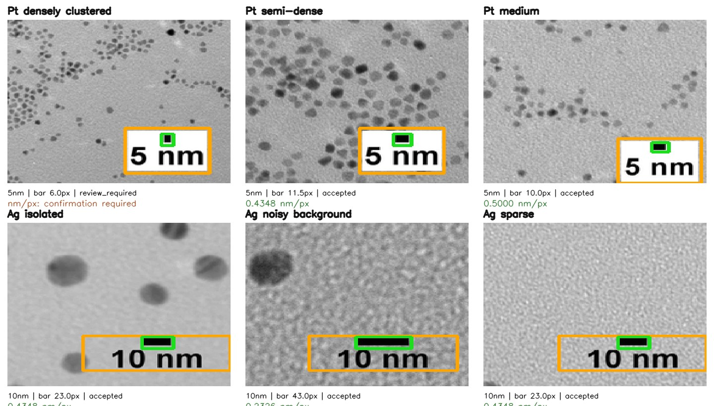

# TEM Nanoparticle Analyzer

**電子顕微鏡画像から金属ナノ粒子の粒子数・形状・粒径分布を推定し、検出結果とその限界を検証するための研究用ソフトウェア。**

[使い方](docs/USER_GUIDE.md) · [解析手法](docs/ARCHITECTURE.md) · [全実験の結果](docs/EXPERIMENTS.md) · [定量評価](docs/VALIDATION.md) · **[全画像157点以上を直接埋め込んだ図アトラス](docs/FIGURE_INDEX.md)**

> **研究プロトタイプ／本番測定の精度保証なし。** 学習済みモデルによって対応する画像が異なります。EMPS（TEM/SEM混合）のF1を、PtのDM3/HRTEM画像での検出精度と読み替えないでください。重なりの3D構造は2D投影像から確定できません。

## 何ができるか

- **画像読み込み**：PNG/JPEG/TIFFの試作系と、RosettaSciIOを用いたDM3/DM4の読み込み（**実ファイル検証はDM3のみ**）。
- **スケール校正**：DM3のX/Y実空間軸からnm/pixelを取得。校正情報がない掲載画像ではスケールバーのOCRと棒の画素幅から換算し、短すぎるバーは保留。縮小倍率やX/Yの非等方性を考慮。
- **粒子抽出**：多尺度特徴 + Random Forest/ExtraTrees、接触粒子のWatershed分離、粒子間境界の教師あり学習。明視野・HRTEMは**別の実験パイプライン**です。
- **採否と監査**：孤立粒子・接触分離・要確認・重なり疑いの記録。人手の二重レビューと不一致の仲裁。
- **結果**：粒子ごとのCSV、円相当径、輪郭付き画像、粒径ヒストグラム、採否理由と校正JSON。
- **評価と再現**：人工画像の正解マスク、実測TEM/SEMのインスタンス正解、GitHub Actions、画像単位のブートストラップ評価。実験版の数値は版ごとに凍結。

## まず画像で見る

### 元のPt/Ag TEM：採否・重なり・スケール




### 実DM3：生画像の校正とHRTEMへの別方式


### 教師ありインスタンス分割：人手正解との照合


**そのほかの結果図・正解マスク・評価画像は省略せず**、[図アトラス](docs/FIGURE_INDEX.md)内のテーマ別Markdownに画像として埋め込みます。元画像の追加・更新時も図索引を自動再生成し、参照漏れをCIで検出します。

## 現時点で分かっている精度

**主指標は粒子ごとの1対1対応（IoU ≥ 0.5）に基づくmicro F1**です。単純な二値マスクのDiceや採用粒子数だけでは、重なりや過剰除外を正しく評価できません。

| 検証 | 評価条件 | 粒子単位F1 | 結論 |
|---|---|---:|---|
| v11 → v13 | EMPS 公式testの同じ8視野、教師28視野 | 15.97% → **53.20%** | **境界を直接学習**すると接触分離が改善。ただし旧8視野を複数回使った開発結果 |
| v13 → v14 | **旧8枚を除いた新しい20視野** | 29.64% → 28.50% | 明暗対称学習は全体でNO-GO。明るい粒子のみ改善 |
| v13(28枚) → v15(96枚) | **旧28枚を除いた別の新しい20視野** | 23.14% → **34.66%** | 教師実画像の増量が有効。Precision 15.60%→25.50%、Recall 44.75%→54.09% |
| v15 の信頼区間 | 上記新20視野、画像単位ペアブートストラップ | F1差 **+11.52ポイント** | 95%区間 +0.92〜+23.01ポイント。別顕微鏡への一般化は未確認 |
| 公開DM3 2件 | ANTEMA由来の実HRTEM | **未評価** | 校正/読込は成功。粒子輪郭の専門家正解がないためF1は報告しない |

ここでいう**新しい20視野**もすべて同じEMPSデータセット内（TEM/SEM混合）であり、研究室・機種・撮影セッションを横断する外部検証ではありません。


詳細な実測データ、失敗例、使用した学習IDは[検証の読み方](docs/VALIDATION.md)と[研究履歴](docs/EXPERIMENTS.md)にまとめました。

## まず実行する

Python 3.11推奨。Windows/WSL、Linuxなどで実行できます。

```bash
git clone https://github.com/tr-o/tem-nanoparticle-analyzer.git
cd tem-nanoparticle-analyzer
python -m pip install -r requirements.txt

# 環境/必要ファイルの確認
python -m tem_analyzer doctor

# 同梱の人工TEM 16枚学習 + 4枚テストを再生成（時間がかかります）
python -m tem_analyzer demo
```

**DM3/DM4を扱う場合**は追加で

```bash
python -m pip install "rosettasciio==0.15.0" gradio
python -m tem_analyzer dm-inspect sample.dm3 --out inspection.json
python -m tem_analyzer dm-analyze sample.dm3 --method hrtem --out my_results
python -m tem_analyzer gui
```

- `dm-analyze --method hrtem` は**v8の探索的テクスチャモデル**で、粒径の確定精度は未検証です。
- `--method brightfield` は以前の教師ありRFを使用できますが、**HRTEMに転用すると大量の誤検出が発生しました**。
- v15は教師あり境界分離の**評価スクリプト**で、DM3用の本番配布済み学習済みモデルではありません。モデルを混同しないでください。
- 16/32-bit画像は元画素値と表示用正規化を区別し、実長の校正が不明な場合はnmを出しません。

[詳しいCLI/GUI手順と出力構造](docs/USER_GUIDE.md)

## リポジトリの構造

```text
tem_analyzer/          # 現行の共通CLI入口（実装は既存実験パイプラインを呼び出す）
experiments/
  v2, v4-v15/          # 再現可能な研究履歴・元コード・評価表・画像
demo_data/             # 人工TEM 16 train / 4 test と正解マスク
results/               # 初期人工画像の保存済み解析結果
reference_tem/         # 出典のある参考画像（再利用条件は各出典に従う）
docs/
  FIGURE_INDEX.md      # 画像をすべて実際に表示するテーマ別アトラス
  ARCHITECTURE.md      # 画像・実寸校正・モデル・採否のデータフロー
  USER_GUIDE.md        # コマンド・GUI・データ形式
  VALIDATION.md        # 指標、データ分割、統計的限界
  EXPERIMENTS.md       # すべての実験レポートへの入口
scripts/               # 図/リンク整合性検査・公開データ再現
.github/workflows/     # 品質チェックと手動の過去実験再現
```

過去の各`vN`を**削除・上書きせず**、`experiments/vN`以下にアーカイブしています。文献画像、弱教師、実測ラベル、検量JSON、解析コードは用途ごとに区別しています。

## 測定結果の読み方と重要な限界

- 円相当径：`d = 2 sqrt(A × sx × sy / pi)`（`sx`, `sy`は実測のnm/pixel）。スケール未校正ならpixel単位のみ。
- **採用数 ≠ 真の粒子数**。小粒子の見落とし、塊の過分割、孤立粒子の誤除外が粒径分布を歪めます。
- **HRTEMの格子縞は粒子の輪郭を保証しません。** v8では従来RFがHRTEMを数千個の偽粒子として認識した失敗も保存。
- 学習画像の一部は**人工**、実画像の一部は**弱教師**です。専門家が独立に付けた正解ラベルとは別物として表示しています。
- 粒子中心検出や明暗対称モデルの試作はNO-GOも含めて記録し、成功だけを選んでいません。
- v13・v14・v15は**テスト視野が異なるため、版をまたいだF1の数値を単純比較しません**。各版内で同じテスト画像を処理した対比較のみ有効です。
- 外部提供画像・DM3のライセンスと再配布の権利は出典に依存します。公開DM3原本はこのリポジトリに同梱していません。

## 研究・保守に使うリンク

[研究バージョン一覧](docs/EXPERIMENTS.md) · [図・正解マスクの全件アトラス](docs/FIGURE_INDEX.md) · [再現・品質チェック](docs/MAINTENANCE.md) · [参照TEM出典](docs/REFERENCE_TEM.md)

**方針：** 新機能は「観測画像」「予測輪郭」「正解マスク」「粒径分布」「評価指標」を同じレポートに残す。画像を追加したら必ずMarkdown本文へ埋め込み、`scripts/check_repository.py`でリンク・全図掲載・構造を検査します。
