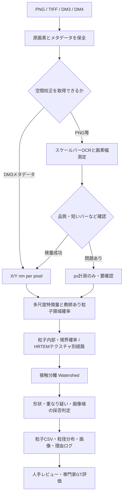

# データフローとソフトウェア構造

[README](../README.md) / [使い方](USER_GUIDE.md) / [評価基準](VALIDATION.md) / [図索引](FIGURE_INDEX.md)

## 解析の全体像

この図は設計概念です。各バージョンにすべてが同時実装されているわけではありません。

## パイプラインを混ぜない

| 主用途 | コード | 根拠と制限 |
|---|---|---|
| 人工TEMのデモ | [初期RF](../tem_analyzer/legacy_rf.py) | 教師16枚・検証4枚は人工画像 |
| Pt/Agの明視野画像 | [v2](../experiments/v2/tem_v2.py)、[v4](../experiments/v4/tem_v4.py) | 弱教師・採否規則。専門家GT不足 |
| スケールバーOCR | [v2 scale](../experiments/v2/scale_calibration.py) | 短いバーは自動確定せず、元解像度参照 |
| DM3/DM4生データI/O | [v8 io](../experiments/v8/dm_io.py) | DM3実ファイル2件で確認。DM4実ファイル未評価 |
| HRTEM格子特徴 | [v8](../experiments/v8/hrtem_texture.py) | Gabor+暗部。教師ありでなく正解未照合 |
| TEM/SEMインスタンス境界 | [v13](../experiments/v13/boundary_model.py)、[v15](../experiments/v15/data_scale_benchmark.py) | EMPS公式インスタンスラベルで検証。DM3へ転用不可 |

## 座標・単位の不変条件

- 原画像画素座標は **(row, col)**、OpenCV描画は **(x, y)=(col, row)**。
- クロップ内部の輪郭は元ROI原点を足して**原画像の座標系に戻す**。v7の修正を回帰テスト。
- 縮小画像のピクセル校正は、横/縦それぞれの倍率だけ増やして保持。
- `A_px × sx_nm/px × sy_nm/px`をnm²に変換し、円相当径は`d=2√(A_nm2/π)`。スケール不明では絶対nm値を出さない。
- 画像とGTは同一視野、寸法、原点を確認し、異なる場合は黙って伸縮させない。

## 運用構造

**`tem_analyzer/` は利用者向けの安定した入口**で、従来の研究コードを明示的に起動します。過去の研究結果を勝手に書き換えません。`experiments/vN`は再現用に保存された研究プロトタイプであり、単独での比較は各README/REPORTの条件を守って行います。

