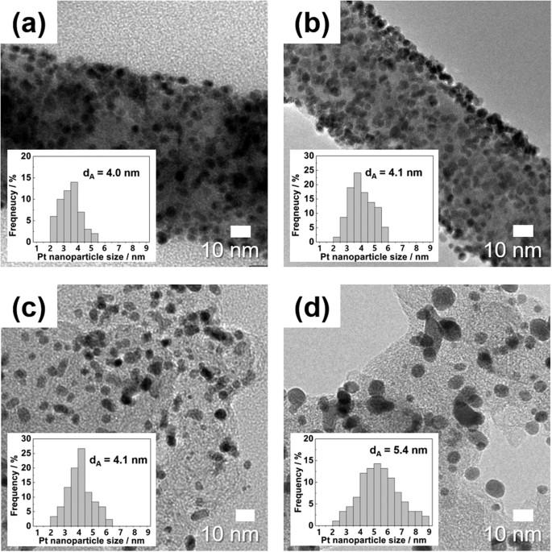
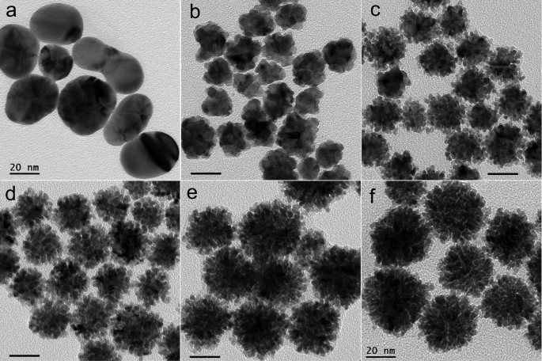

# 参考TEM画像ギャラリー（公開資料・外部参照）

最初の候補10件の**出典目録**です。これらは研究・メーカーが公開したTEM画像であり、`demo_data/`の**模擬TEM教師データとは完全に別物**です。

> **権利上の区別：** 本リポジトリに第三者の画像そのものを無断で再配布しません。画像を外部サイトから表示する場合も、表示先サイトの仕様や権利者の判断で表示できないことがあります。論文のCCライセンスの場合も個別のクレジットを確認してください。元画像の学習利用・改変・再公開には適用されるライセンスを確認してください。

## 01 Ptの孤立・球形粒子

[Universidad de AlicanteのPtナノ粒子ギャラリー](https://web.ua.es/es/leqa/nanoparticulas-galeria-de-fotos.html) — 球形粒子、基本的な検出。大学サイト掲載、再配布条件未確認。

## 02 Ptの低コントラスト粒子

[MetrohmのPt nanoparticle TEM資料](https://www.metrohm.com/en/products/d/rp-p/drp-ptnp-col.html) — 背景ノイズと微小粒子。再配布条件未確認。

## 03 Ptの高密度粒子

[nanoComposix: 5 nm Platinum Nanoparticles](https://nanocomposix.com/products/5-nm-platinum-nanoparticles) — 接触粒子と密度の高い領域。**外部ホスト画像。画像データはリポ内には保存しない。**

## 04 Ptの粒径ばらつき

[In situ TEM investigation on the evolution of Pt](https://sciup.org/in-situ-transmission-electron-microscopy-investigation-on-the-evolution-of-pt-142232050) — 粒径分布幅。複合図からの切り出し・スケールの校正が必要。

## 05 担持Ptの複雑な背景

[Scientific Reports 44411](https://www.nature.com/articles/srep44411) — 支持体の濃淡とPt粒子。原論文Figure 4、CC BY 4.0。**出典・権利はreference_tem/README.mdを参照。**

## 06 Pt/Cの凝集粒子

[Membranes 12(3), 301](https://www.mdpi.com/2077-0375/12/3/301) — 支持膜/カーボンと粒子の識別。外部画像は参照元のアクセス制限により表示されない場合があります。

## 07 Pt/Cの微小粒子

[Nanomaterials 12(21), 3800](https://www.mdpi.com/2079-4991/12/21/3800) — 微小粒子の検出漏れ評価。外部画像は参照元のアクセス制限により表示されない場合があります。

## 08 AuPt合金の複雑な形状

[Scientific Reports 40103](https://www.nature.com/articles/srep40103) — 合金粒子の形状・凝集度。明視野TEM Figure 2参照。複合図の各パネルの意味に注意。**Figure 2原画像をCC BY 4.0で保存**。He et al. (2017), DOI:10.1038/srep40103, Figure 2, © authors, CC BY 4.0; 第三者著作物クレジットがないことを確認。

## 09 Agの孤立粒子

[nanoComposix: 10 nm Silver Nanospheres](https://nanocomposix.com/products/10-nm-silver-nanospheres) — 比較的単純な球形粒子。**外部ホスト画像。**

## 10 Auのほぼ均一な球形粒子

[nanoComposix Ultra Uniform Gold Nanospheres](https://nanocomposix.com/collections/ultra-uniform-gold-nanospheres) — 形の揃った粒子。再配布条件未確認。

---

### 画像の扱いと用途

- 初期の**人手アノテーション候補**は01・02・03・08。公開図のスケールバー・キャプション・ラベル・ヒストグラムを含んだまま学習へ投入しない。
- このギャラリーは**出典リスト**であり、未確認のライセンスの画像をリポジトリにコピーしたものではない。
- **論文の平均粒径を100%再現する必要はない**。個別粒子をどれだけ正確に検出し、分離・測定できたかを評価する。
