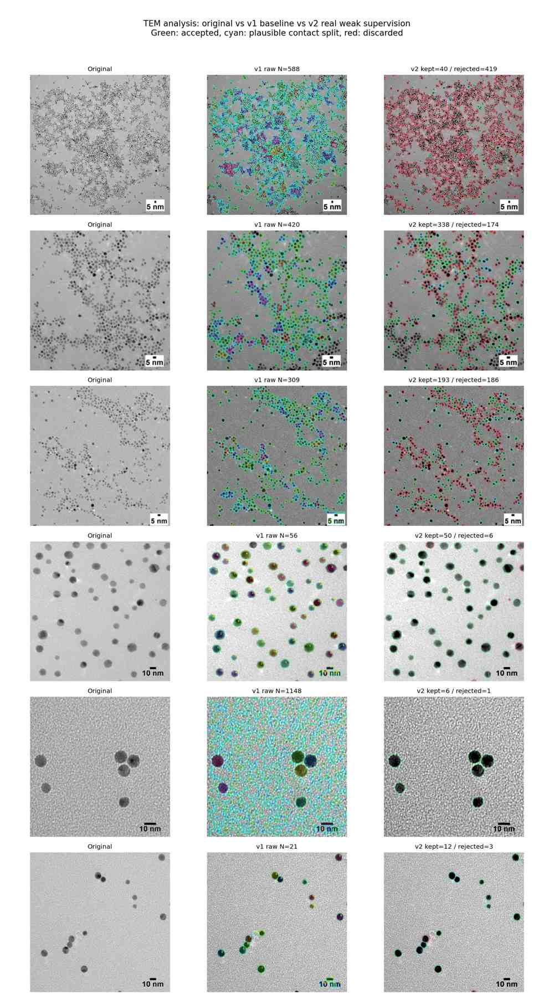
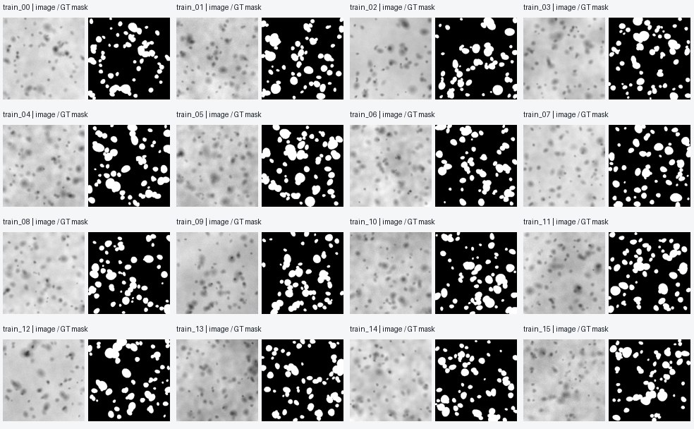
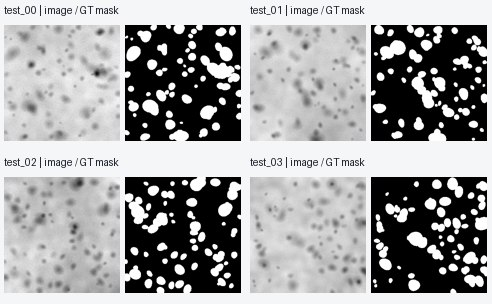
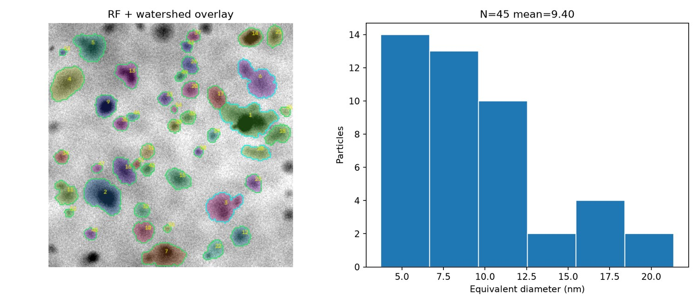
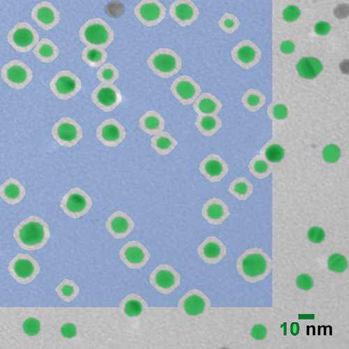
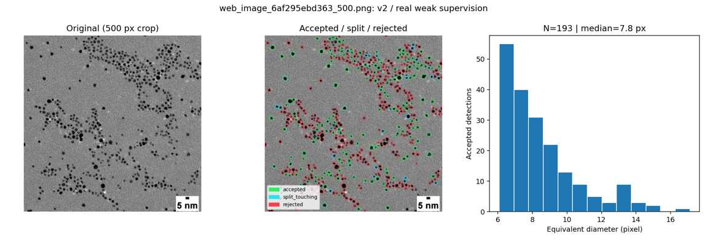
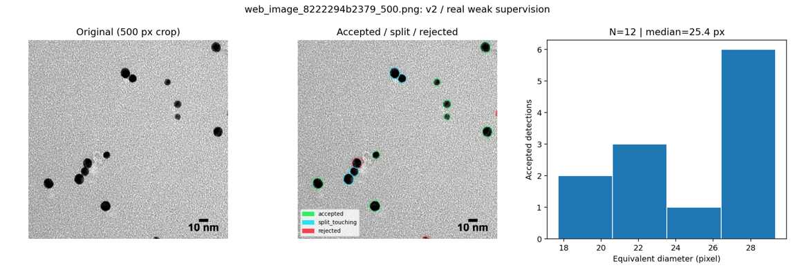
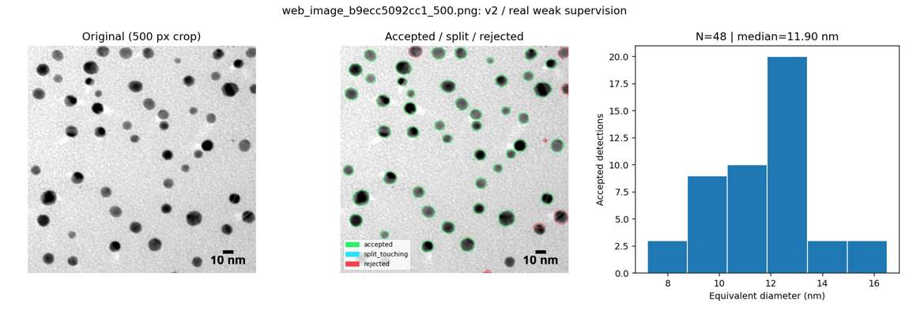
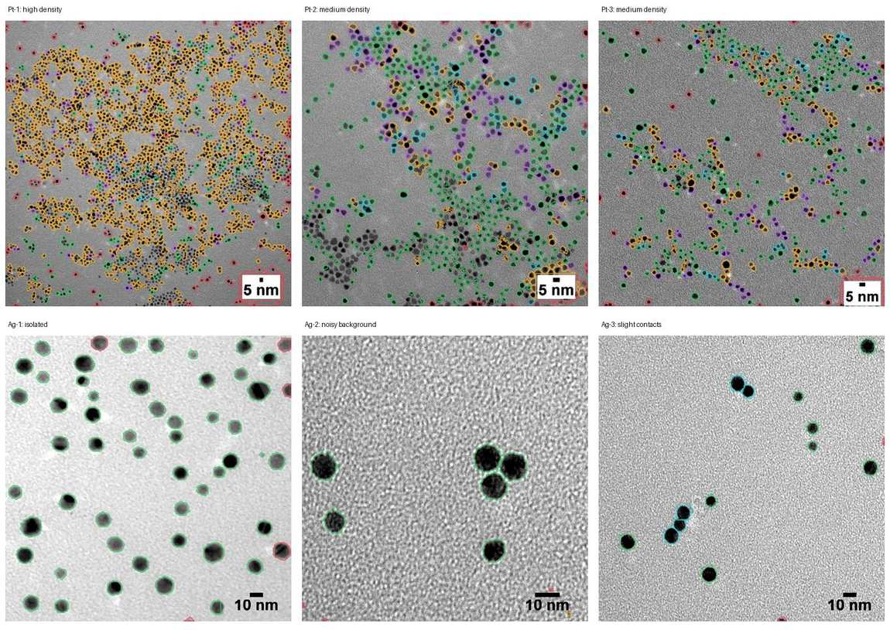
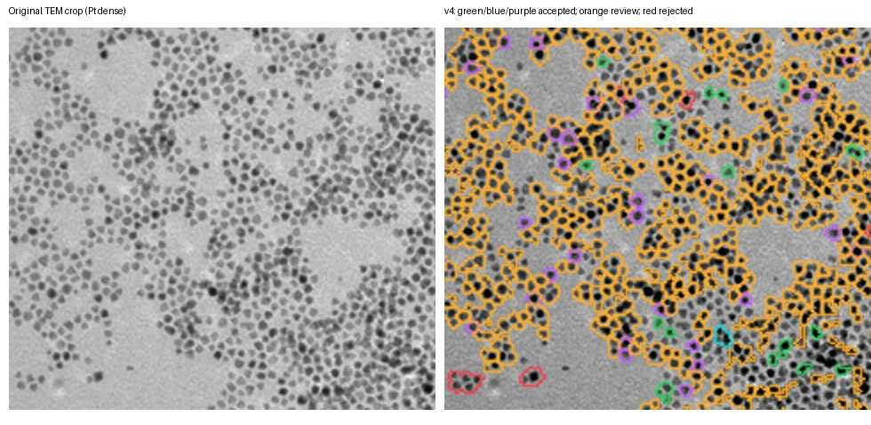

**[最新v8：公開DM3の元画像解析・nm校正・HRTEM適応実験（画像12点）](../v8/INDEX.md)**

# TEMナノ粒子粒径解析 — 統合研究レポート

**[最新v5：高密度Ptの過剰除外監査・36候補画像・再審査ワークフロー](../v5/REPORT.md)**


> **2026-10-28 | v1 → v2 → v3.1 | 実験TEM 6視野 + 模擬TEM 20視野**  
> **判定：研究用プロトタイプ。実測TEMの独立した専門家アノテーションによる精度検証は未実施。**  
> このページに載せる解析図・学習データプレビュー・スケール検量図は、**すべてMarkdown本文内に画像として表示**しています。縮小画像の背後にある元の実測TEM図は、著作権・再利用条件を確認してから別途取得してください。

## 0. 先に見る図と結論

**6枚の実験TEMに同じ解析パイプラインを適用した比較**。これらは論文の粒径値との一致を目的にしていません。



- **孤立Ag粒子**：v3.1（15-tree軽量モデル）で49候補を採用し、OCR + スケールバーから得た **0.435 nm/px** で換算。円相当径の中央値 **11.40 nm**。
- **背景が非常にざらつくAg粒子**：旧モデルの1,148候補に対し、v2では6候補採用。これは**同じ画像を弱教師学習にも利用した結果**なので、未知画像での性能改善を証明しない。
- **密集Pt**：検出領域は拾えるが、複数粒子の重なり・接触を保守的に除外するため、真の粒子数を過小評価しうる。
- **スケールバー**：「5 nm」「10 nm」のOCRとバー幅からnm/pxを計算。短すぎるバー、画像対応の不一致、OCRの失敗時は **nmへ自動換算しない**。

**結論：明るい背景に孤立した金属ナノ粒子が写る明視野TEMでは有望。一方、実画像の汎用的な検出精度や粒径誤差を主張できる段階ではない。**

## 1. 何を解析するのか

粒子領域を輝度で二値化するだけの方法ではない。v1は多尺度画像特徴量 + Random Forest、v2/v3は模擬データと弱教師の実画像を用いた **ExtraTrees分類器**。Watershedはインスタンス分離の後処理であり、現時点では独立した教師ありインスタンス分割器ではない。

```text
TEM image
  ├─ [v3] OCR + horizontal-bar geometry → nm/px または review_required
  ├─ スケール文字・バーの除外マスク
  ├─ 多尺度局所特徴量 → Random Forest / ExtraTrees → 粒子確率
  ├─ マーカー制御Watershed → 粒子候補（接触候補は分離）
  ├─ 面積・形状・局所コントラスト・密集度で採用／除外
  └─ 円相当径 d = sqrt(4A / π) → CSV・輪郭・ヒストグラム
```

**重なりの扱い**：投影像で境界が見えず確定できない凝集は、原則として除外/要確認。単に接触する2粒子は分離を試行する。ただし`split_touching`というラベルは**アルゴリズム上の判定**であって、3Dの非重なりを証明しない。

## 2. 教師データと評価条件

### 2.1 模擬TEM：16枚学習 + 4枚テスト

**人工的に生成した画像**で、実験TEMではない。マスクは生成器の正解であり、専門家による実測画像ラベルとは区別する。







v1の初期試験は画素Dice ≈0.913、IoU ≈0.839、粒子中心のPrecision ≈0.989、Recall ≈0.652（模擬画像のみ）。後の同条件再評価（4枚）では以下のとおり。**v2は実験画像への適応を増やした一方、模擬画像でのDiceがわずかに低下**した。

| 模擬テスト4枚の平均 | v1 | v2 |
|---|---:|---:|
| 画素Dice | 0.9108 | 0.9043 |
| 画素IoU | 0.8363 | 0.8254 |

この差はモデル改善の包括的証明にも失敗判定にもならない。実測TEMの独立正解マスクが必要。

### 2.2 実画像の弱教師3枚（**人手検証済みのGTではない**）

実際のPt/Agメーカー公開画像の縮小版を使い、粒子中心の一部を目視指定しつつヒューリスティックで補助ラベルを生成した。**255=確実そうな粒子コア、0=確実そうな背景、128=不確かな領域（学習から除外）**。3視野は学習にも使っているため、その視野での改善は**学習内適合**として解釈する。

#### Ag・孤立粒子の補助ラベル



#### Ag・複雑な背景の補助ラベル


#### Pt・中密度の補助ラベル


実画像の取得元：[nanoComposix Pt 5 nm](https://nanocomposix.com/products/5-nm-platinum-nanoparticles) / [nanoComposix Ag 10 nm](https://nanocomposix.com/products/10-nm-silver-nanospheres)。**これらの製品ページ記載の公称粒径は学習ラベルにも検量にも使用していない。** 外部画像の再配布権・元の16-bit TEMデータへのアクセスは本プロジェクトから保証されない。

## 3. 実験TEM 6枚：v1対v2

全6枚は1000×1000 pxの公開図を500×500 pxに縮小して解析したもの。粒径のpx値は縮小画像に対する値。

| ID | 視野 | v2弱教師に使用 | v1の生検出 | v2候補 | v2採用 | v2のうち接触分離採用 | v2除外 |
|---|---|---|---:|---:|---:|---:|---:|
| Pt-1 | 高密度 | いいえ | 588 | 459 | 40 | 4 | 419 |
| Pt-2 | 中密度 | **はい** | 420 | 512 | 338 | 47 | 174 |
| Pt-3 | 中密度 | いいえ | 309 | 379 | 193 | 27 | 186 |
| Ag-1 | 孤立 | **はい** | 56 | 56 | 50 | 0 | 6 |
| Ag-2 | ノイズ大 | **はい** | 1,148 | 7 | 6 | 0 | 1 |
| Ag-3 | 少数・接触あり | いいえ | 21 | 15 | 12 | 4 | 3 |

**注意：** v2採用数には右列の接触分離採用数を含む。比較しているのはアルゴリズム上の検出候補数と採否であって、実際に存在する粒子数、precision/recall、正解率ではない。v1→v2でモデル・分割・採否規則も同時に変わっている。

### 3.1 Pt-1：密集が最も難しい例


輪郭の広い連結塊が残りやすい。v2は459候補のうち40（接触分離4を含む）しか採用せず、**過剰除外の可能性**が大きい。PoCの実用域では未解決。

### 3.2 Pt-2：弱教師に使った中密度例


接触分離は部分的に機能。**学習にも使った視野**なので汎化の根拠にはしない。

### 3.3 Pt-3：学習に使っていないPt視野



比較的多くの候補を採用するが、真の境界が不明な凝集の判定には引き続き課題。

### 3.4 Ag-1：孤立粒子


最も自然な抽出例。ただし**弱教師で使用**。

### 3.5 Ag-2：背景ノイズの強い失敗例を改善


v1は背景を大量に拾う。v2は目視で確認しやすい粒子を中心に採用。**同じ視野の補助ラベルを与えた結果であり、独立評価ではない。**

### 3.6 Ag-3：少数の粒子と接触



12候補を採用、うち4候補は接触分離による。軽い接触は処理できるが分離正解率は未測定。

## 4. v3：スケールバー除外・自動検量

画像内のスケール注記と粒子を別扱いする。処理は以下の通り。

1. 主に右下のスケール注記領域を探し、OCRで数字と `nm/µm/pm/Å` などの単位を抽出。
2. 数字の近傍で水平バーを検出し、**バー幅 `L_px` と表記長 `L_nm` から `nm_per_px = L_nm/L_px`** とする。
3. 参照元1000 px画像で測った場合、同一視野との画素相関（閾値0.97）を確かめて500 px解析画像へ倍率補正。
4. スケール線と「10 nm」などの文字を囲む**除外マスク**を作り、粒子抽出から除く。
5. バーが短い場合（参照画像で18 px未満）、単位を読めても `review_required` とし、**自動nm換算しない**。明示的手動確認のみ許可。

**スケール検出診断：緑がバー、橙が除外する注記領域**


### 4.1 同じ視野の高解像度1000 px画像から検量した結果

| 視野 | OCR文字列 | 元画像のバー幅 | 500 pxでのnm/px | 自動換算 |
|---|---|---:|---:|---|
| Pt-1 | 5 nm | 12 px | —（暫定値あり） | **保留** |
| Pt-2 | 5 nm | 23 px | 0.435 | 採用 |
| Pt-3 | 5 nm | 20 px | 0.500 | 採用 |
| Ag-1 | 10 nm | 46 px | 0.435 | 採用 |
| Ag-2 | 10 nm | 86 px | 0.233 | 採用 |
| Ag-3 | 10 nm | 46 px | 0.435 | 採用 |

例：Ag-1の10 nmバーを元画像で46 pxと計測すると、1000 pxの画像では `10/46 = 0.2174 nm/px`。500 pxへ半分に縮小して解析すると `0.2174 × 2 = 0.4348 nm/px`。この**縮小倍率の補正は必須**。

**注意：ここでの読み取り誤差はバー両端を±2 px程度とする簡易見積りに基づくもので、校正された測定不確かさではない。** 本来はTEM取得メタデータのピクセルサイズを優先する。右下以外の配置、複数パネル、斜めバーは未検証。画像の寸法が一致しても、視野の異なる参照画像は適用しない。

### 4.2 nm単位で表示した実測画像の解析例（v3.1の15-tree軽量モデル）

**Pt-2：採用346候補（孤立283 + 接触分離63）、円相当径中央値 3.80 nm**


**Ag-1：採用49候補、円相当径中央値 11.40 nm**



モデルがv2表の48-treeと異なるため、**v2件数とv3.1件数の差をスケール機能だけの効果として解釈しない**。どちらの中央値も、専門家ラベルとの照合なしに粒径精度が保証されたものではない。

### 4.3 v3.1軽量モデルの全6視野の概要

| 視野 | 解析候補 | 採用 | 接触分離採用（採用数に含む） | 除外 | 粒径中央値 |
|---|---:|---:|---:|---:|---|
| Pt-1 | 472 | 34 | 3 | 438 | **6.91 px**（検量保留） |
| Pt-2 | 527 | 346 | 63 | 181 | **3.80 nm** |
| Pt-3 | 398 | 186 | 23 | 212 | **7.90 px**（500 px像ではバーが短く保留。元画像で別途検量可） |
| Ag-1 | 56 | 49 | 0 | 7 | **11.40 nm** |
| Ag-2 | 8 | 5 | 0 | 3 | **11.24 nm** |
| Ag-3 | 15 | 12 | 4 | 3 | **11.55 nm** |

ここでは同じ計測条件でも、元画像から検量できた場合と500 px画像単体で保留になった場合を区別している。**対応する元画像を使えば再検量できる**が、表の値は実際に出力された各ジョブの状態を正確に記載したもの。

## 5. 品質保証・失敗モード

| 確認対象 | 現状 | 次に必要な検証 |
|---|---|---|
| 模擬TEM画素セグメンテーション | 数値評価あり | 実測TEMで独立評価 |
| 弱教師の実測画像 | 3視野で実装 | アノテーションの専門家レビュー |
| 接触粒子の分割 | 単体テストPASS | 接触・重なりの人手インスタンス正解 |
| 重なりの除外 | 形状・コントラスト・密集度に基づく | 過剰除外と取りこぼしを定量評価 |
| スケール文字・バー除外 | 6画像で動作例、6単体テスト | 右下以外のレイアウト、極小バー |
| 長さのnm換算 | 6例中5例で元画像の自動採用 | メタデータによる独立照合 |
| 再現性 | ソース・軽量モデル・模擬データ保存 | 公開図の元画像取得条件、依存ライブラリ固定 |

重要なのは「検出数を増やす」だけを目的にしないこと。採用率と誤検出率のトレードオフを持つため、**判断困難候補は除外し、除外理由・座標はログに残す**。

## 6. GitHubで再実行する方法

```bash
# ルートから
pip install -r requirements.txt
# OCR自動検量では追加で Tesseract 本体と pytesseract が必要
python -m unittest v2/test_scale_calibration.py

# テスト画像は同じ視野、scale-referenceはできれば元解像度
python v2/tem_v2.py predict \
  --image path/to/tem_500.png \
  --scale-reference path/to/tem_1000.png \
  --model v2/model_rf_real_weak_portable.joblib

# GUI
python v2/app_v3.py
```

- 各結果の `particles_all.csv` は**採否とその理由の記録**、`particles_accepted.csv` は採用候補の統計。
- `calibration.json` はOCR文字、バー画素長、nm/px、`accepted/review_required`、視野一致度などを保存。
- 人工生成データはリポジトリ内に含むが、実験TEMの元画像は再配布条件に依存するため必ずしも同梱していない。
- **15-treeポータブル学習済みモデルと、学習で作成するフルモデルは異なる**。論文級の性能評価にはモデルバージョンの固定が必要。

## 7. 画像の出典・研究ノート

今回の実験画像は、初期に候補として集めた10件のうち取得・処理できた**Ptの3視野とAgの3視野**。候補10件すべてを解析・再配布したわけではない。参考画像の出典は[初期画像リスト](#画像候補の参照先)を参照。

### 画像候補の参照先

| 候補 | 出典 |
|---|---|
| Pt孤立粒子 | [Universidad de Alicante](https://web.ua.es/es/leqa/nanoparticulas-galeria-de-fotos.html) |
| Pt低コントラスト | [Metrohm](https://www.metrohm.com/en/products/d/rp-p/drp-ptnp-col.html) |
| Pt高密度 | [nanoComposix 5 nm Pt](https://nanocomposix.com/products/5-nm-platinum-nanoparticles) |
| Pt粒径のばらつき | [In-situ TEM study](https://sciup.org/in-situ-transmission-electron-microscopy-investigation-on-the-evolution-of-pt-142232050) |
| 担持Pt | [Scientific Reports](https://www.nature.com/articles/srep44411) |
| Pt/C凝集 | [Membranes](https://www.mdpi.com/2077-0375/12/3/301) |
| Pt/C極小粒子 | [Nanomaterials](https://www.mdpi.com/2079-4991/12/21/3800) |
| AuPt合金凝集 | [Scientific Reports](https://www.nature.com/articles/srep40103) |
| Ag孤立球形粒子 | [nanoComposix 10 nm Ag](https://nanocomposix.com/products/10-nm-silver-nanospheres) |
| Au均一粒子 | [nanoComposix Gold](https://nanocomposix.com/collections/ultra-uniform-gold-nanospheres) |

候補の外部画像はリンク先の権利に従って参照。**本レポートに直接埋め込んだのは、GitHubに実体のあるデモ・解析・検量・弱教師プレビュー図**である。研究用の引用/紹介と、原画像の自由な再配布を混同しない。

## 8. 関連ドキュメント

- [模擬教師データと再現方法](TRAINING_DATA.md)
- [初版の解析手法](METHODS.md)
- [v2の実画像比較記録](../v2/REPORT.md)
- [v3のスケール検量詳細](../v2/SCALE_CALIBRATION.md)
- [実行・学習・GUIの手順](../v2/README_GITHUB.md)
- [再現性チェック結果](../v2/checks.json)

**この統合レポートを更新時の入口とし、過去バージョンのレポートは履歴・再現性を追跡する資料として残す。**


## v4：過剰除外の再評価（2026-10-28）

**[📊 v4画像付き詳細レポート：Pt・Ag実画像6視野のv3.1/v4比較、採用・要確認・除外の色分け](../v4/REPORT.md)**





高密度Ptで自動採用候補34→192。v4は **緑：孤立採用／シアン：接触分離採用／紫：再分離採用／橙：要確認／赤：除外** の5種類を保存します。橙は粒径統計から除きます。v4は校正済みスケールバー処理を継承し、短いPt-1バーではnm換算を保留します。人工生成TEM4枚（328中心）の対応検出はv3.1が171、v4が172。**実測TEMの人手正解との照合は未実施のため、採用数の増加＝精度向上ではありません**。
