# 教師データ・テストデータ（模擬TEM）

**この画像は実験TEMではありません。** 2026年試作の人工的な明視野TEM風画像です。研究論文やメーカーの写真から切り出したものではありません。

## 学習（16枚、画像・GTマスク1:1）

- 生成条件：`python -m tem_analyzer.legacy_rf generate-demo --out demo_data --train 16 --test 4`
- train seed: 900–915、画像サイズ320×320 px、70個の模擬粒子中心を生成。
- 生画像：`demo_data/train/images/train_00.png` ～ `train_15.png`
- 対応マスク：`demo_data/train/masks/train_00.png` ～ `train_15.png`
- 生成中心および半径：`demo_data/train/instances/train_00.json` ～ `train_15.json`
- 二値マスクは**画素の粒子／背景**を表します。複数粒子の輪郭を個別に区別するインスタンスマスクではありません。

### 1枚ずつ

| 画像 | 対応する教師マスク |
|---|---|
| 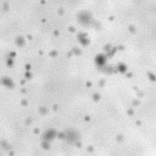 | 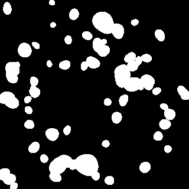 |
| 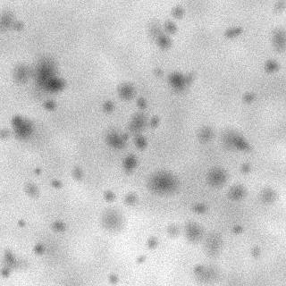 | 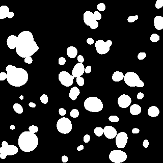 |
| 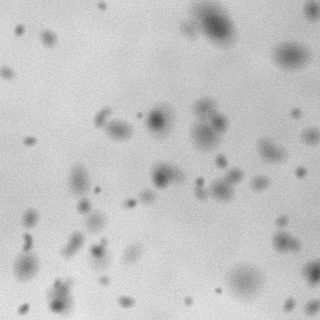 | 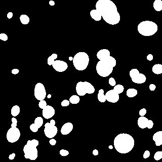 |
| 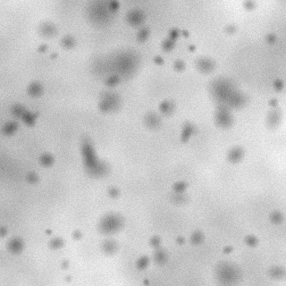 | 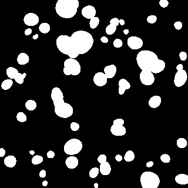 |

残りの画像・マスクも上記と同じ構造で`train_04`～`train_15`として保存しています。

## 独立テスト（4枚）

| 画像 | 対応するGT |
|---|---|
| 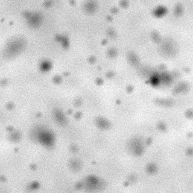 | 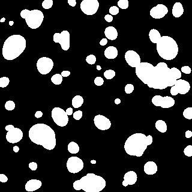 |
| 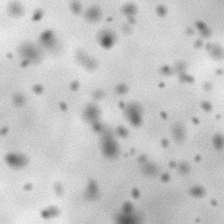 | 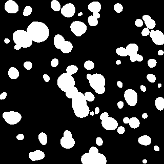 |
| 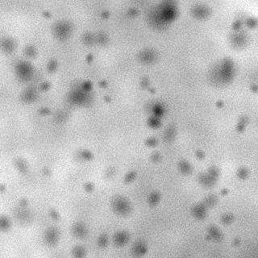 | 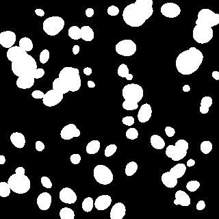 |
| 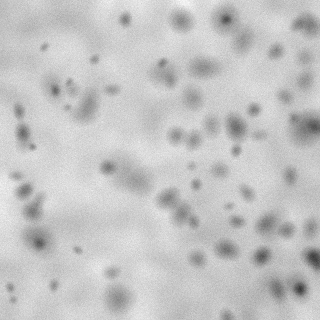 | 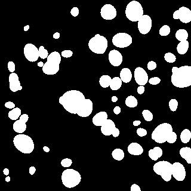 |

test seed: 1900–1903、模擬粒子中心82個/枚。trainとは異なるseedですが画像生成器は共通であり、実験TEMへの汎化性能は評価していません。

## 評価図

物理単位の`0.4 nm/px`は**模擬的な表示値**です。TEMの倍率校正ではありません。粒子分離の失敗や見落としを必ず輪郭で目視確認してください。

## 再現性

データそのものもGitで保存する方針です。生成には同一環境・同一乱数seedを用い、コードや依存ライブラリの更新で完全に同じpixel値にならない場合は既存のPNGを原本とします。
