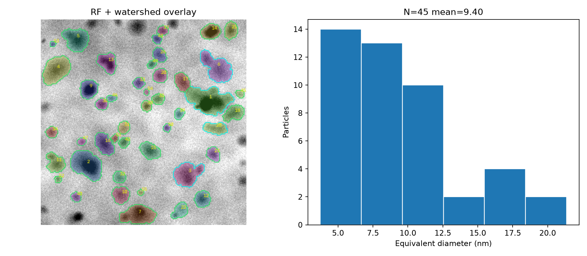

# 利用方法

[トップ](../README.md) / [解析手法](ARCHITECTURE.md) / [研究履歴](EXPERIMENTS.md)

## 環境

Python 3.11で開発・CIを実行。学習済みモデルを使うには、対応する`scikit-learn`等のバージョンにも注意すること。

```bash
python -m pip install -r requirements.txt
python -m tem_analyzer doctor
```

DM3/DM4とGUIは任意依存：

```bash
python -m pip install "rosettasciio==0.15.0" gradio
```

共通CLIとモデル用途は[コード運用状況](CODE_STATUS.md)・[配布モデル一覧](../models/README.md)を参照。v13/v15のF1は現在の配布モデルの精度を意味しません。

## 1. 同梱人工TEMで動作確認

```bash
python -m tem_analyzer demo
```

`demo_data/train` 16画像と`demo_data/test` 4画像の各マスクを用い、旧RFを学習・評価。**この結果は実TEMの精度ではない**。



## 2. DM3を読んで校正を確認

```bash
python -m tem_analyzer dm-inspect sample.dm3 --out inspection.json
```

DM3/DM4が複数データセットを含むときは解析対象を明示。3Dのスタックならフレームを指定。X/Yのscaleとunitsがnmへ換算できなければ`calibration_status=missing_or_unsupported_units`となり、nm径は出さない。

## 3. DM3を試験解析

```bash
python -m tem_analyzer dm-analyze sample.dm3 --method hrtem --out out/hrtem
python -m tem_analyzer dm-analyze sample.dm3 --method brightfield --out out/brightfield
```

`hrtem`は**v8 Gabor方式**の探索結果。`brightfield`は旧RFで、HRTEMに適用した場合の大量の誤検出を実際に確認。いずれも未検証のDM画像で粒径分布を確定するためのモデルではありません。

GUI：

```bash
python -m tem_analyzer gui
```

## 4. 出力

一般に、`overlay.png`または`overview.jpg`には粒子輪郭・暫定ヒストグラム、`particles*.csv`には各粒子のpixel寸法／校正径と採否、`summary.json`には元画像・設定・計測値・バージョン情報が記録されます。出力名は実験版により異なるため、`[experiments/vN/REPORT.md]`で確認してください。

**採用・要確認・除外はモデルの判定**であり、専門家の正解判定ではありません。重なりの強い粒子、微小粒子、焦点外れ、画像端、HRTEMの位相コントラストで精度が低下します。

## 5. 精度を研究として検証

`experiments/v10`以降は[EMPS](https://github.com/by256/emps)の公式train/test、インスタンスID付きマスクを使用します。インストール後、各バージョンのコマンドを使用するか、GitHubのActions画面で履歴ワークフローを手動実行してください。

- [v13 境界の教師あり学習](../experiments/v13/REPORT.md)
- [v14 明暗反転・新しい20枚](../experiments/v14/REPORT.md)
- [v15 教師96枚・別の新20枚](../experiments/v15/REPORT.md)

**EMPSはTEM/SEM混合**。配布済みのv15学習済みDM3専用モデルがあるわけではありません。

## 6. 日常メンテナンス

```bash
python scripts/refactor_repository.py   # 初回だけ移行。以後は図アトラスを更新
python scripts/check_repository.py       # 画像掲載漏れ・リンク切れ検査
python -m unittest discover -s tests -v
```

[詳しい品質管理](MAINTENANCE.md)
