# 教師用模擬TEM・正解マスク・初期結果

掲載画像：**59点**。図は掲載時の分析バージョンであり、
最新の性能やモデルの正しさを保証するものではありません。

## \`demo_data/test/images/\`

### 1. \`test_00.png\`

原ファイル：[\`demo_data/test/images/test_00.png\`](../../demo_data/test/images/test_00.png)

### 2. \`test_01.png\`

原ファイル：[\`demo_data/test/images/test_01.png\`](../../demo_data/test/images/test_01.png)

### 3. \`test_02.png\`

原ファイル：[\`demo_data/test/images/test_02.png\`](../../demo_data/test/images/test_02.png)

### 4. \`test_03.png\`

原ファイル：[\`demo_data/test/images/test_03.png\`](../../demo_data/test/images/test_03.png)

## \`demo_data/test/masks/\`

### 5. \`test_00.png\`

原ファイル：[\`demo_data/test/masks/test_00.png\`](../../demo_data/test/masks/test_00.png)

### 6. \`test_01.png\`

原ファイル：[\`demo_data/test/masks/test_01.png\`](../../demo_data/test/masks/test_01.png)

### 7. \`test_02.png\`

原ファイル：[\`demo_data/test/masks/test_02.png\`](../../demo_data/test/masks/test_02.png)

### 8. \`test_03.png\`

原ファイル：[\`demo_data/test/masks/test_03.png\`](../../demo_data/test/masks/test_03.png)

## \`demo_data/train/images/\`

### 9. \`train_00.png\`

原ファイル：[\`demo_data/train/images/train_00.png\`](../../demo_data/train/images/train_00.png)

### 10. \`train_01.png\`

原ファイル：[\`demo_data/train/images/train_01.png\`](../../demo_data/train/images/train_01.png)

### 11. \`train_02.png\`

原ファイル：[\`demo_data/train/images/train_02.png\`](../../demo_data/train/images/train_02.png)

### 12. \`train_03.png\`

原ファイル：[\`demo_data/train/images/train_03.png\`](../../demo_data/train/images/train_03.png)

### 13. \`train_04.png\`

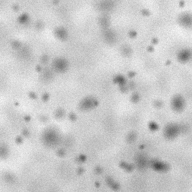

原ファイル：[\`demo_data/train/images/train_04.png\`](../../demo_data/train/images/train_04.png)

### 14. \`train_05.png\`

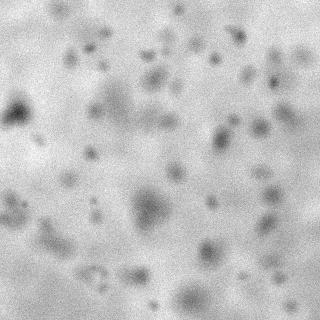

原ファイル：[\`demo_data/train/images/train_05.png\`](../../demo_data/train/images/train_05.png)

### 15. \`train_06.png\`

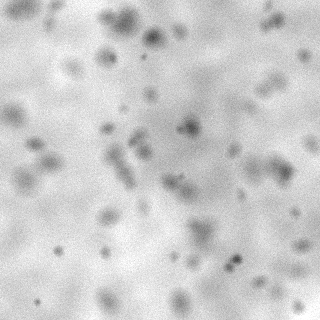

原ファイル：[\`demo_data/train/images/train_06.png\`](../../demo_data/train/images/train_06.png)

### 16. \`train_07.png\`

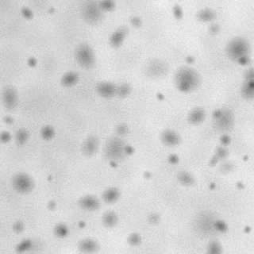

原ファイル：[\`demo_data/train/images/train_07.png\`](../../demo_data/train/images/train_07.png)

### 17. \`train_08.png\`

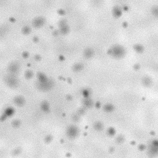

原ファイル：[\`demo_data/train/images/train_08.png\`](../../demo_data/train/images/train_08.png)

### 18. \`train_09.png\`

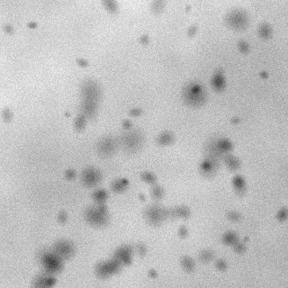

原ファイル：[\`demo_data/train/images/train_09.png\`](../../demo_data/train/images/train_09.png)

### 19. \`train_10.png\`

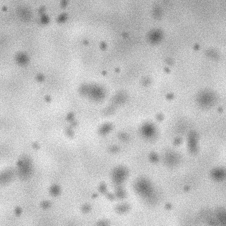

原ファイル：[\`demo_data/train/images/train_10.png\`](../../demo_data/train/images/train_10.png)

### 20. \`train_11.png\`

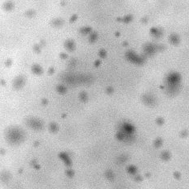

原ファイル：[\`demo_data/train/images/train_11.png\`](../../demo_data/train/images/train_11.png)

### 21. \`train_12.png\`

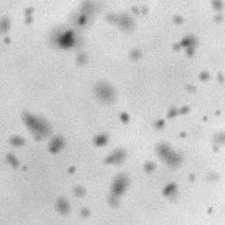

原ファイル：[\`demo_data/train/images/train_12.png\`](../../demo_data/train/images/train_12.png)

### 22. \`train_13.png\`

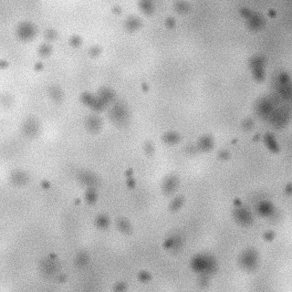

原ファイル：[\`demo_data/train/images/train_13.png\`](../../demo_data/train/images/train_13.png)

### 23. \`train_14.png\`

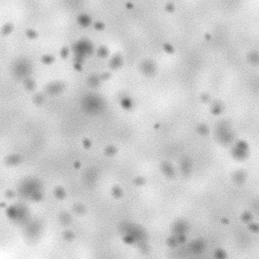

原ファイル：[\`demo_data/train/images/train_14.png\`](../../demo_data/train/images/train_14.png)

### 24. \`train_15.png\`

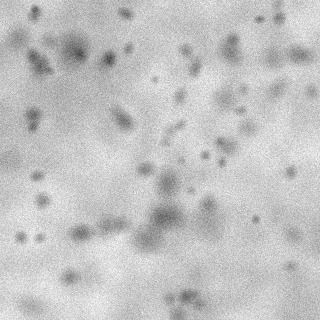

原ファイル：[\`demo_data/train/images/train_15.png\`](../../demo_data/train/images/train_15.png)

## \`demo_data/train/masks/\`

### 25. \`train_00.png\`

原ファイル：[\`demo_data/train/masks/train_00.png\`](../../demo_data/train/masks/train_00.png)

### 26. \`train_01.png\`

原ファイル：[\`demo_data/train/masks/train_01.png\`](../../demo_data/train/masks/train_01.png)

### 27. \`train_02.png\`

原ファイル：[\`demo_data/train/masks/train_02.png\`](../../demo_data/train/masks/train_02.png)

### 28. \`train_03.png\`

原ファイル：[\`demo_data/train/masks/train_03.png\`](../../demo_data/train/masks/train_03.png)

### 29. \`train_04.png\`

原ファイル：[\`demo_data/train/masks/train_04.png\`](../../demo_data/train/masks/train_04.png)

### 30. \`train_05.png\`

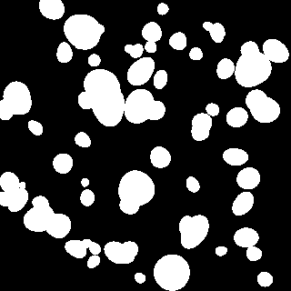

原ファイル：[\`demo_data/train/masks/train_05.png\`](../../demo_data/train/masks/train_05.png)

### 31. \`train_06.png\`

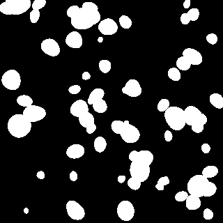

原ファイル：[\`demo_data/train/masks/train_06.png\`](../../demo_data/train/masks/train_06.png)

### 32. \`train_07.png\`

原ファイル：[\`demo_data/train/masks/train_07.png\`](../../demo_data/train/masks/train_07.png)

### 33. \`train_08.png\`

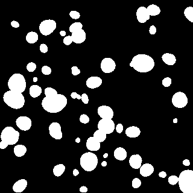

原ファイル：[\`demo_data/train/masks/train_08.png\`](../../demo_data/train/masks/train_08.png)

### 34. \`train_09.png\`

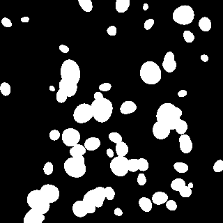

原ファイル：[\`demo_data/train/masks/train_09.png\`](../../demo_data/train/masks/train_09.png)

### 35. \`train_10.png\`

原ファイル：[\`demo_data/train/masks/train_10.png\`](../../demo_data/train/masks/train_10.png)

### 36. \`train_11.png\`

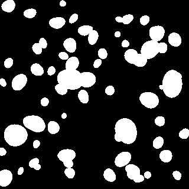

原ファイル：[\`demo_data/train/masks/train_11.png\`](../../demo_data/train/masks/train_11.png)

### 37. \`train_12.png\`

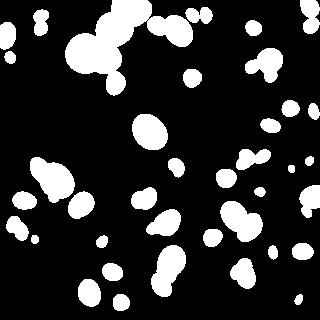

原ファイル：[\`demo_data/train/masks/train_12.png\`](../../demo_data/train/masks/train_12.png)

### 38. \`train_13.png\`

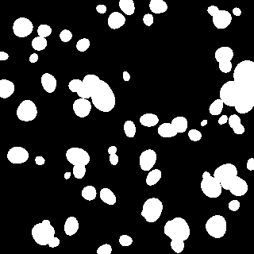

原ファイル：[\`demo_data/train/masks/train_13.png\`](../../demo_data/train/masks/train_13.png)

### 39. \`train_14.png\`

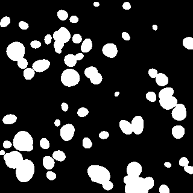

原ファイル：[\`demo_data/train/masks/train_14.png\`](../../demo_data/train/masks/train_14.png)

### 40. \`train_15.png\`

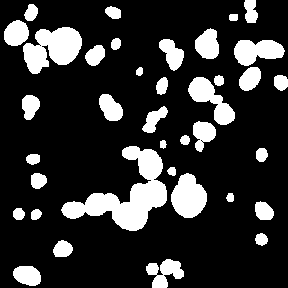

原ファイル：[\`demo_data/train/masks/train_15.png\`](../../demo_data/train/masks/train_15.png)

## \`docs/\`

### 41. \`analysis_overview.jpg\`

原ファイル：[\`docs/analysis_overview.jpg\`](../analysis_overview.jpg)

### 42. \`test_contact_sheet.jpg\`

原ファイル：[\`docs/test_contact_sheet.jpg\`](../test_contact_sheet.jpg)

### 43. \`train_contact_sheet.jpg\`

原ファイル：[\`docs/train_contact_sheet.jpg\`](../train_contact_sheet.jpg)

## \`results/test_00/\`

### 44. \`mask.png\`

原ファイル：[\`results/test_00/mask.png\`](../../results/test_00/mask.png)

### 45. \`overlay.png\`

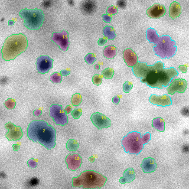

原ファイル：[\`results/test_00/overlay.png\`](../../results/test_00/overlay.png)

### 46. \`overview.png\`

原ファイル：[\`results/test_00/overview.png\`](../../results/test_00/overview.png)

### 47. \`probability.png\`

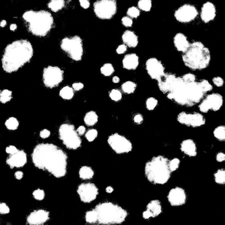

原ファイル：[\`results/test_00/probability.png\`](../../results/test_00/probability.png)

## \`results/test_01/\`

### 48. \`mask.png\`

原ファイル：[\`results/test_01/mask.png\`](../../results/test_01/mask.png)

### 49. \`overlay.png\`

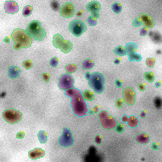

原ファイル：[\`results/test_01/overlay.png\`](../../results/test_01/overlay.png)

### 50. \`overview.png\`

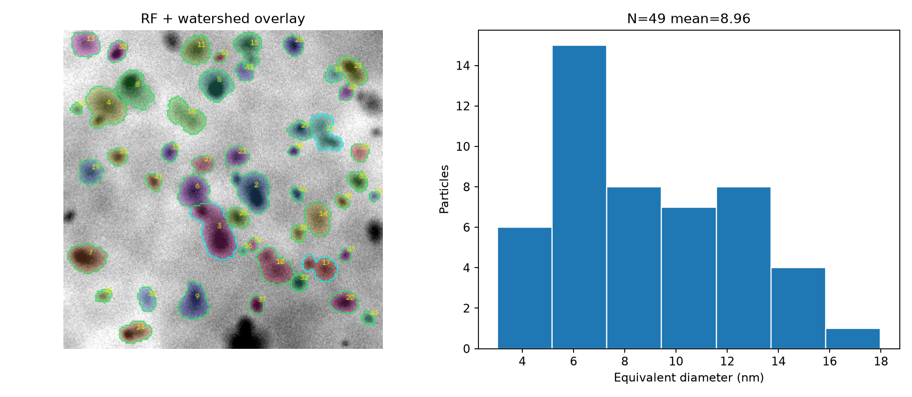

原ファイル：[\`results/test_01/overview.png\`](../../results/test_01/overview.png)

### 51. \`probability.png\`

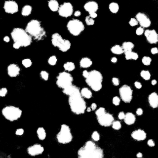

原ファイル：[\`results/test_01/probability.png\`](../../results/test_01/probability.png)

## \`results/test_02/\`

### 52. \`mask.png\`

原ファイル：[\`results/test_02/mask.png\`](../../results/test_02/mask.png)

### 53. \`overlay.png\`

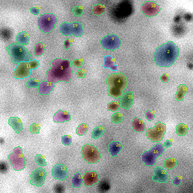

原ファイル：[\`results/test_02/overlay.png\`](../../results/test_02/overlay.png)

### 54. \`overview.png\`

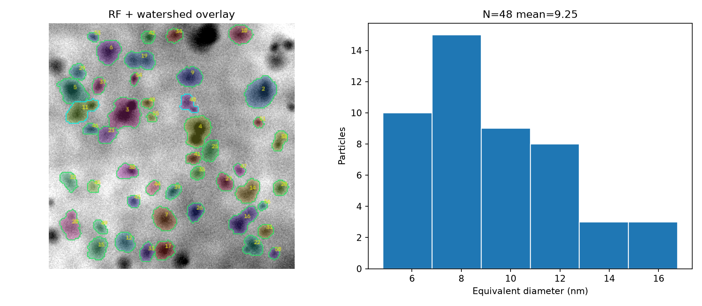

原ファイル：[\`results/test_02/overview.png\`](../../results/test_02/overview.png)

### 55. \`probability.png\`

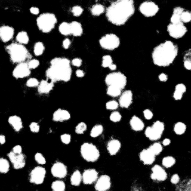

原ファイル：[\`results/test_02/probability.png\`](../../results/test_02/probability.png)

## \`results/test_03/\`

### 56. \`mask.png\`

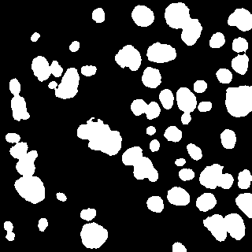

原ファイル：[\`results/test_03/mask.png\`](../../results/test_03/mask.png)

### 57. \`overlay.png\`

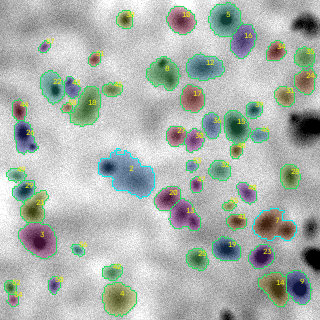

原ファイル：[\`results/test_03/overlay.png\`](../../results/test_03/overlay.png)

### 58. \`overview.png\`

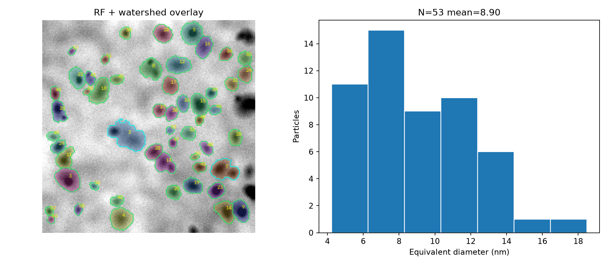

原ファイル：[\`results/test_03/overview.png\`](../../results/test_03/overview.png)

### 59. \`probability.png\`

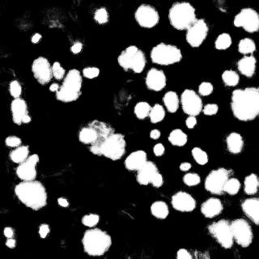

原ファイル：[\`results/test_03/probability.png\`](../../results/test_03/probability.png)

