# Pt/Ag実画像・検量・初期画像

掲載画像：**32点**。図は掲載時の分析バージョンであり、
最新の性能やモデルの正しさを保証するものではありません。

## \`experiments/v2/\`

### 1. \`calibration_6_images.jpg\`

原ファイル：[\`experiments/v2/calibration_6_images.jpg\`](../../experiments/v2/calibration_6_images.jpg)

### 2. \`comparison_6_images.jpg\`

原ファイル：[\`experiments/v2/comparison_6_images.jpg\`](../../experiments/v2/comparison_6_images.jpg)

## \`experiments/v2/results/web_image_2bed876c2a14_500/\`

### 3. \`overview.jpg\`

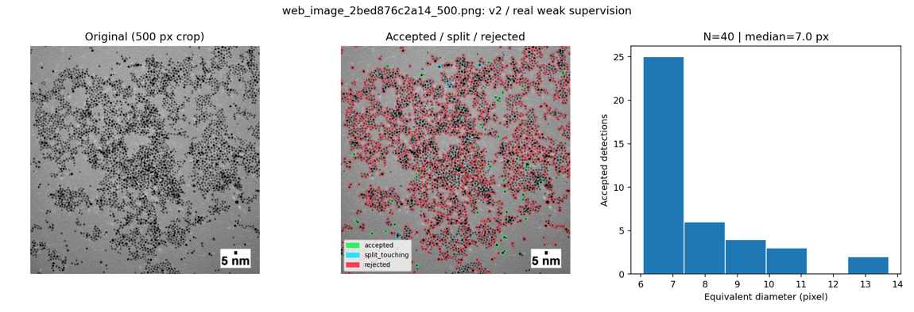

原ファイル：[\`experiments/v2/results/web_image_2bed876c2a14_500/overview.jpg\`](../../experiments/v2/results/web_image_2bed876c2a14_500/overview.jpg)

## \`experiments/v2/results/web_image_6af295ebd363_500/\`

### 4. \`overview.jpg\`

原ファイル：[\`experiments/v2/results/web_image_6af295ebd363_500/overview.jpg\`](../../experiments/v2/results/web_image_6af295ebd363_500/overview.jpg)

## \`experiments/v2/results/web_image_8222294b2379_500/\`

### 5. \`overview.jpg\`

原ファイル：[\`experiments/v2/results/web_image_8222294b2379_500/overview.jpg\`](../../experiments/v2/results/web_image_8222294b2379_500/overview.jpg)

## \`experiments/v2/results/web_image_82853817b188_500/\`

### 6. \`overview.jpg\`

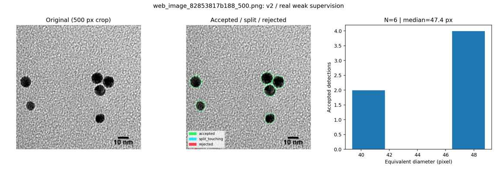

原ファイル：[\`experiments/v2/results/web_image_82853817b188_500/overview.jpg\`](../../experiments/v2/results/web_image_82853817b188_500/overview.jpg)

## \`experiments/v2/results/web_image_9828c4ba32bc_500/\`

### 7. \`overview.jpg\`

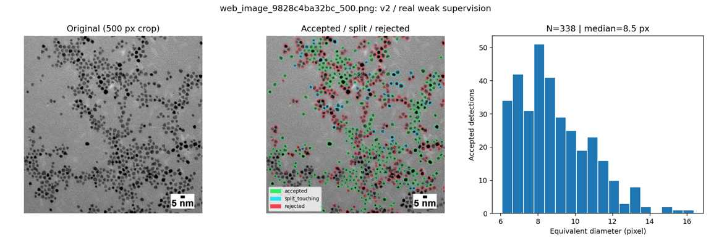

原ファイル：[\`experiments/v2/results/web_image_9828c4ba32bc_500/overview.jpg\`](../../experiments/v2/results/web_image_9828c4ba32bc_500/overview.jpg)

## \`experiments/v2/results/web_image_b9ecc5092cc1_500/\`

### 8. \`overview.jpg\`

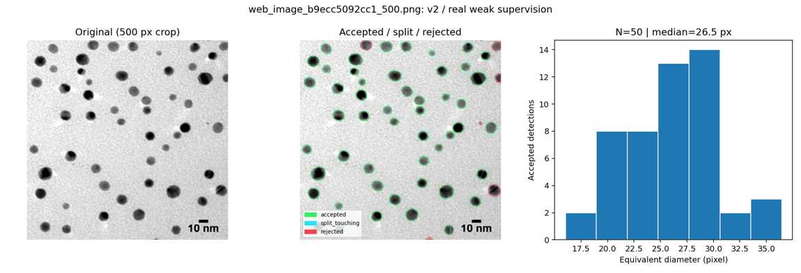

原ファイル：[\`experiments/v2/results/web_image_b9ecc5092cc1_500/overview.jpg\`](../../experiments/v2/results/web_image_b9ecc5092cc1_500/overview.jpg)

## \`experiments/v2/results_v3/Ag_isolated/\`

### 9. \`overview.jpg\`

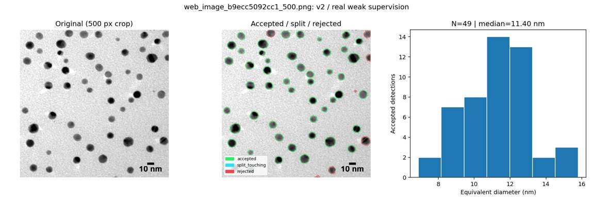

原ファイル：[\`experiments/v2/results_v3/Ag_isolated/overview.jpg\`](../../experiments/v2/results_v3/Ag_isolated/overview.jpg)

## \`experiments/v2/results_v3/Pt_reference/\`

### 10. \`overview.jpg\`

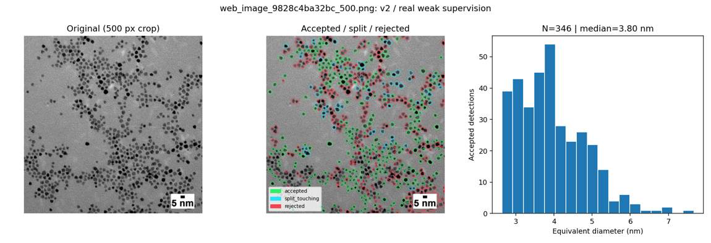

原ファイル：[\`experiments/v2/results_v3/Pt_reference/overview.jpg\`](../../experiments/v2/results_v3/Pt_reference/overview.jpg)

## \`experiments/v2/weak_labels/ag_isolated/\`

### 11. \`label_preview.jpg\`

原ファイル：[\`experiments/v2/weak_labels/ag_isolated/label_preview.jpg\`](../../experiments/v2/weak_labels/ag_isolated/label_preview.jpg)

### 12. \`labels.png\`

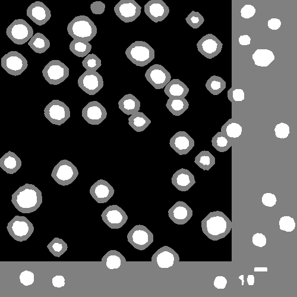

原ファイル：[\`experiments/v2/weak_labels/ag_isolated/labels.png\`](../../experiments/v2/weak_labels/ag_isolated/labels.png)

## \`experiments/v2/weak_labels/ag_noisy/\`

### 13. \`label_preview.jpg\`

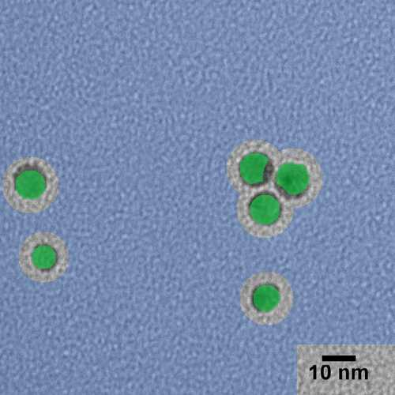

原ファイル：[\`experiments/v2/weak_labels/ag_noisy/label_preview.jpg\`](../../experiments/v2/weak_labels/ag_noisy/label_preview.jpg)

### 14. \`labels.png\`

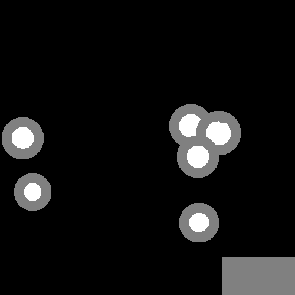

原ファイル：[\`experiments/v2/weak_labels/ag_noisy/labels.png\`](../../experiments/v2/weak_labels/ag_noisy/labels.png)

## \`experiments/v2/weak_labels/pt_semi_dense/\`

### 15. \`label_preview.jpg\`

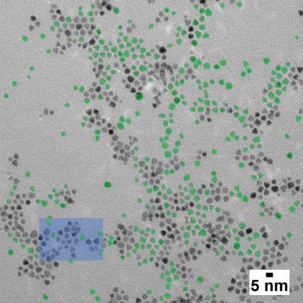

原ファイル：[\`experiments/v2/weak_labels/pt_semi_dense/label_preview.jpg\`](../../experiments/v2/weak_labels/pt_semi_dense/label_preview.jpg)

### 16. \`labels.png\`

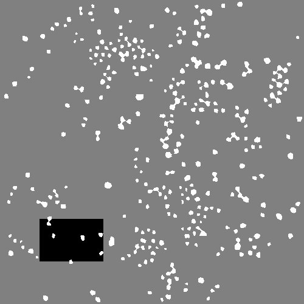

原ファイル：[\`experiments/v2/weak_labels/pt_semi_dense/labels.png\`](../../experiments/v2/weak_labels/pt_semi_dense/labels.png)

## \`experiments/v4/docs/\`

### 17. \`pt1_zoom_audit.jpg\`

原ファイル：[\`experiments/v4/docs/pt1_zoom_audit.jpg\`](../../experiments/v4/docs/pt1_zoom_audit.jpg)

### 18. \`v4_all_six_audit.jpg\`

原ファイル：[\`experiments/v4/docs/v4_all_six_audit.jpg\`](../../experiments/v4/docs/v4_all_six_audit.jpg)

### 19. \`web_image_2bed876c2a14_500_overview.jpg\`

原ファイル：[\`experiments/v4/docs/web_image_2bed876c2a14_500_overview.jpg\`](../../experiments/v4/docs/web_image_2bed876c2a14_500_overview.jpg)

### 20. \`web_image_2bed876c2a14_500_v3.jpg\`

原ファイル：[\`experiments/v4/docs/web_image_2bed876c2a14_500_v3.jpg\`](../../experiments/v4/docs/web_image_2bed876c2a14_500_v3.jpg)

### 21. \`web_image_6af295ebd363_500_overview.jpg\`

原ファイル：[\`experiments/v4/docs/web_image_6af295ebd363_500_overview.jpg\`](../../experiments/v4/docs/web_image_6af295ebd363_500_overview.jpg)

### 22. \`web_image_6af295ebd363_500_v3.jpg\`

原ファイル：[\`experiments/v4/docs/web_image_6af295ebd363_500_v3.jpg\`](../../experiments/v4/docs/web_image_6af295ebd363_500_v3.jpg)

### 23. \`web_image_8222294b2379_500_overview.jpg\`

原ファイル：[\`experiments/v4/docs/web_image_8222294b2379_500_overview.jpg\`](../../experiments/v4/docs/web_image_8222294b2379_500_overview.jpg)

### 24. \`web_image_8222294b2379_500_v3.jpg\`

原ファイル：[\`experiments/v4/docs/web_image_8222294b2379_500_v3.jpg\`](../../experiments/v4/docs/web_image_8222294b2379_500_v3.jpg)

### 25. \`web_image_82853817b188_500_overview.jpg\`

原ファイル：[\`experiments/v4/docs/web_image_82853817b188_500_overview.jpg\`](../../experiments/v4/docs/web_image_82853817b188_500_overview.jpg)

### 26. \`web_image_82853817b188_500_v3.jpg\`

原ファイル：[\`experiments/v4/docs/web_image_82853817b188_500_v3.jpg\`](../../experiments/v4/docs/web_image_82853817b188_500_v3.jpg)

### 27. \`web_image_9828c4ba32bc_500_overview.jpg\`

原ファイル：[\`experiments/v4/docs/web_image_9828c4ba32bc_500_overview.jpg\`](../../experiments/v4/docs/web_image_9828c4ba32bc_500_overview.jpg)

### 28. \`web_image_9828c4ba32bc_500_v3.jpg\`

原ファイル：[\`experiments/v4/docs/web_image_9828c4ba32bc_500_v3.jpg\`](../../experiments/v4/docs/web_image_9828c4ba32bc_500_v3.jpg)

### 29. \`web_image_b9ecc5092cc1_500_overview.jpg\`

原ファイル：[\`experiments/v4/docs/web_image_b9ecc5092cc1_500_overview.jpg\`](../../experiments/v4/docs/web_image_b9ecc5092cc1_500_overview.jpg)

### 30. \`web_image_b9ecc5092cc1_500_v3.jpg\`

原ファイル：[\`experiments/v4/docs/web_image_b9ecc5092cc1_500_v3.jpg\`](../../experiments/v4/docs/web_image_b9ecc5092cc1_500_v3.jpg)

## \`reference_tem/\`

### 31. \`05_Pt_supported_srep44411_fig4.jpg\`

原ファイル：[\`reference_tem/05_Pt_supported_srep44411_fig4.jpg\`](../../reference_tem/05_Pt_supported_srep44411_fig4.jpg)

### 32. \`08_AuPt_srep40103_fig2.jpg\`

原ファイル：[\`reference_tem/08_AuPt_srep40103_fig2.jpg\`](../../reference_tem/08_AuPt_srep40103_fig2.jpg)

