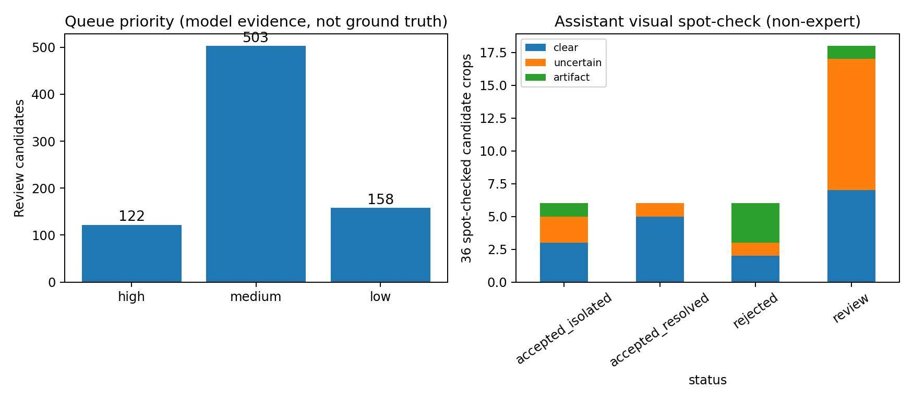
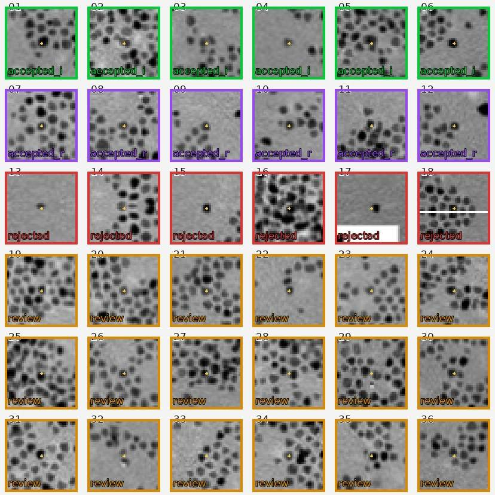
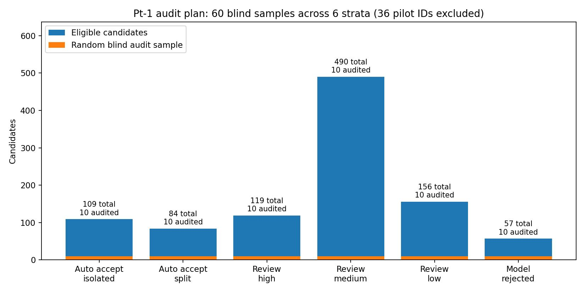
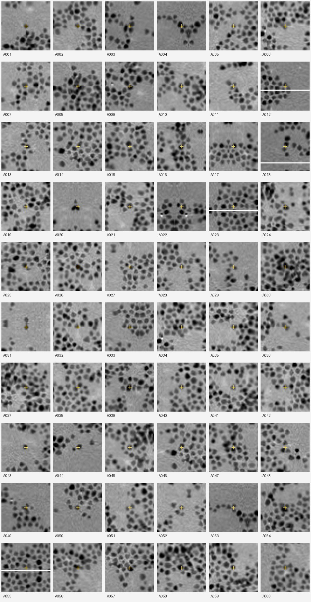

# 重なり判定・人手レビュー・座標診断

掲載画像：**7点**。図は掲載時の分析バージョンであり、
最新の性能やモデルの正しさを保証するものではありません。

## \`experiments/v5/\`

### 1. \`audit_counts.jpg\`

原ファイル：[\`experiments/v5/audit_counts.jpg\`](../../experiments/v5/audit_counts.jpg)

### 2. \`spotcheck_blind.jpg\`

原ファイル：[\`experiments/v5/spotcheck_blind.jpg\`](../../experiments/v5/spotcheck_blind.jpg)

### 3. \`spotcheck_status.jpg\`

原ファイル：[\`experiments/v5/spotcheck_status.jpg\`](../../experiments/v5/spotcheck_status.jpg)

### 4. \`spotcheck_visual_assessment.jpg\`

原ファイル：[\`experiments/v5/spotcheck_visual_assessment.jpg\`](../../experiments/v5/spotcheck_visual_assessment.jpg)

## \`experiments/v6/audit/\`

### 5. \`audit_allocation.jpg\`

原ファイル：[\`experiments/v6/audit/audit_allocation.jpg\`](../../experiments/v6/audit/audit_allocation.jpg)

### 6. \`blind_gallery.jpg\`

原ファイル：[\`experiments/v6/audit/blind_gallery.jpg\`](../../experiments/v6/audit/blind_gallery.jpg)

## \`experiments/v7/\`

### 7. \`roi_offset_schematic.svg\`

原ファイル：[\`experiments/v7/roi_offset_schematic.svg\`](../../experiments/v7/roi_offset_schematic.svg)

