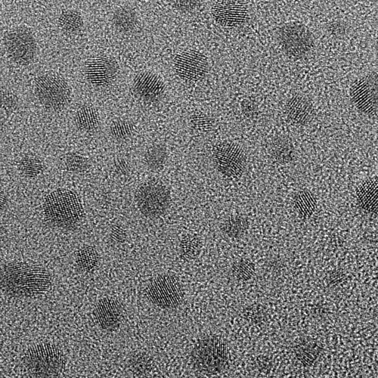
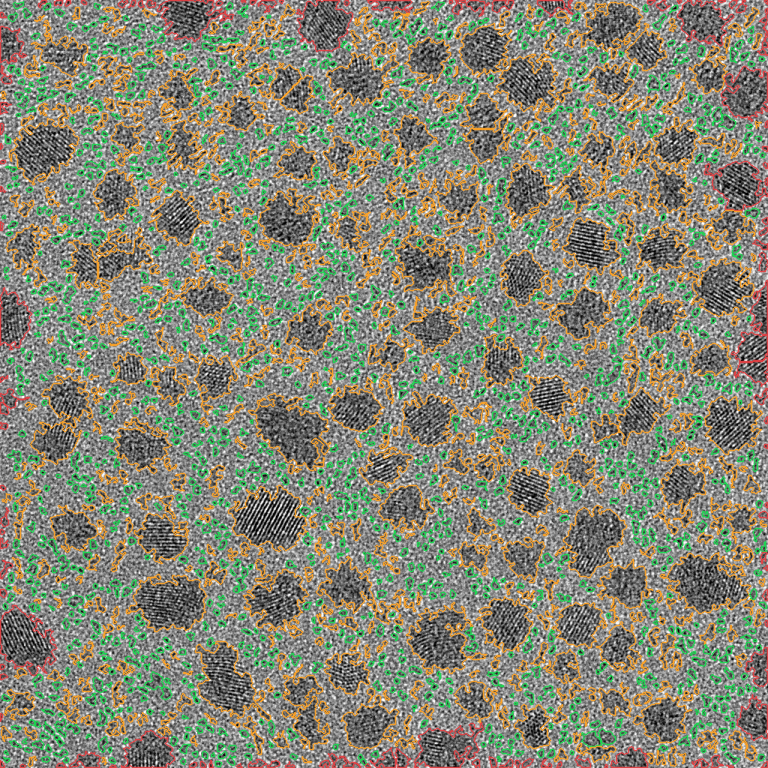
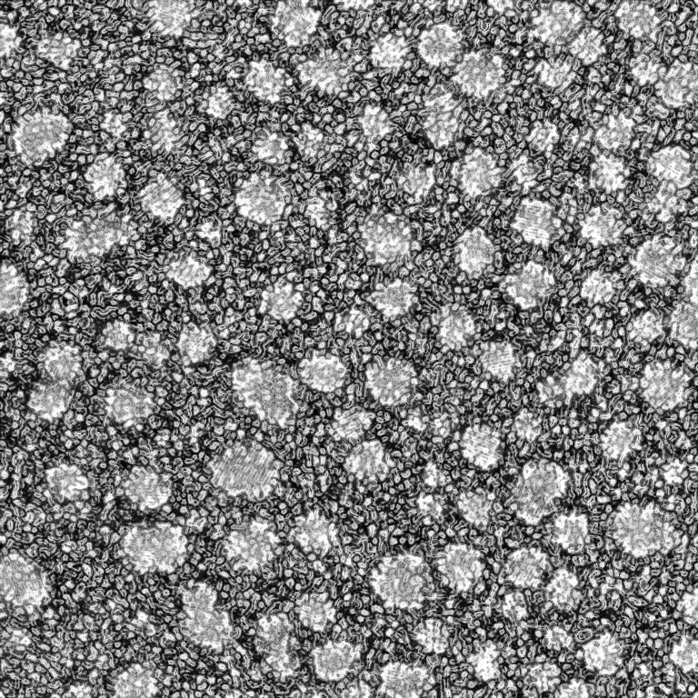
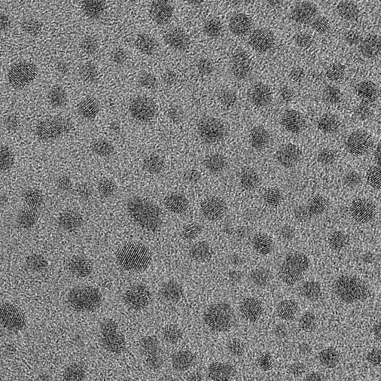
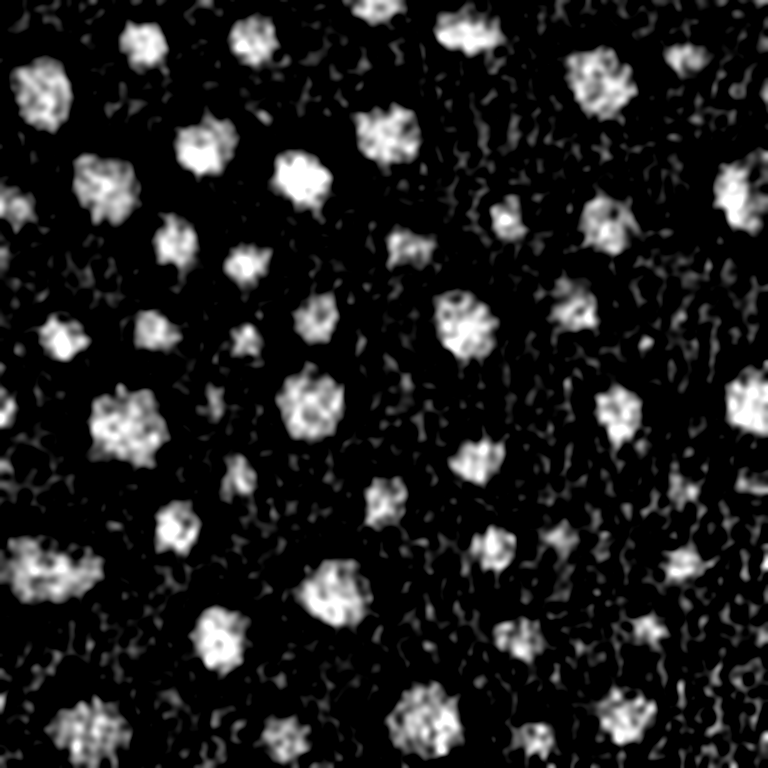
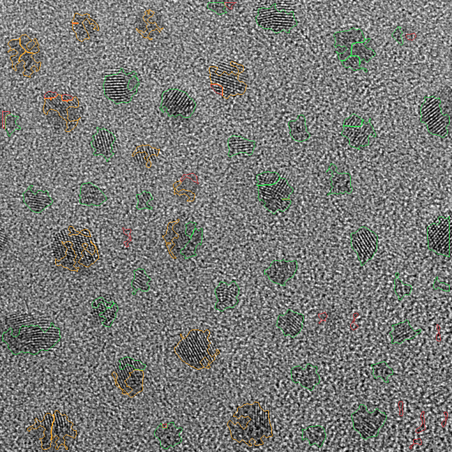
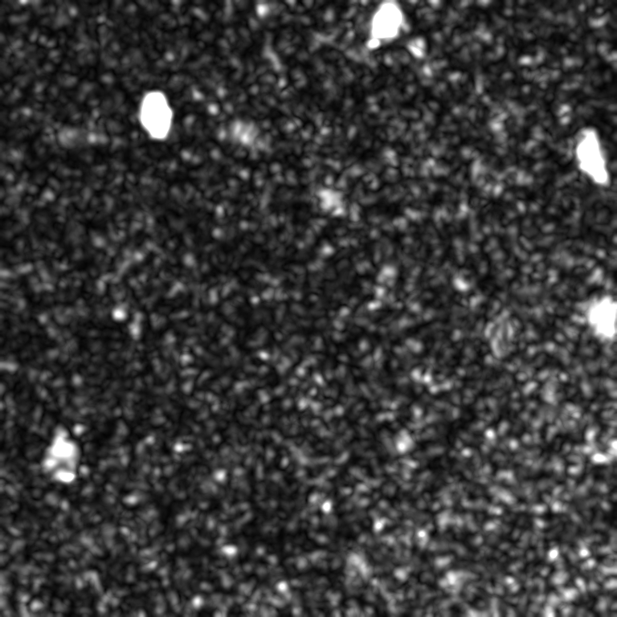
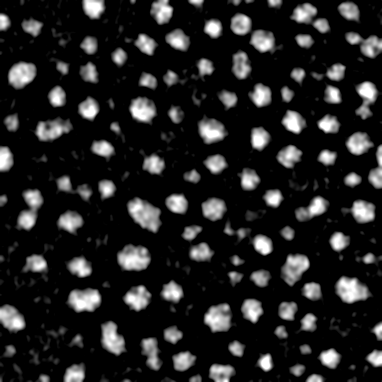
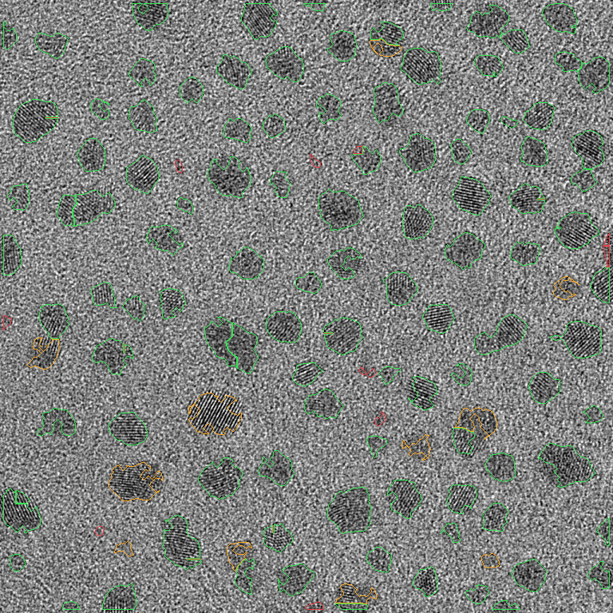
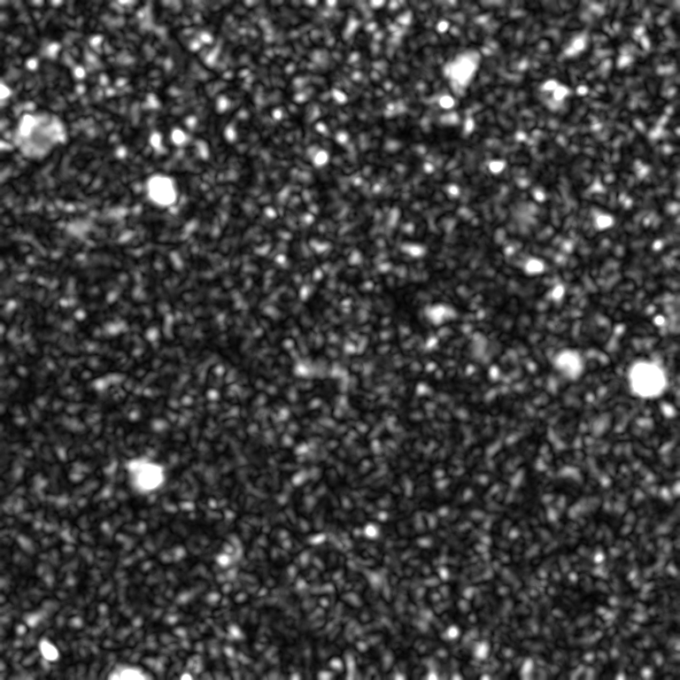

# 実DM3・結晶格子・HRTEM検出

掲載画像：**18点**。図は掲載時の分析バージョンであり、
最新の性能やモデルの正しさを保証するものではありません。

## \`experiments/v8/results/NP-TEM-Image1/\`

### 1. \`overlay.png\`

原ファイル：[\`experiments/v8/results/NP-TEM-Image1/overlay.png\`](../../experiments/v8/results/NP-TEM-Image1/overlay.png)

### 2. \`overview.jpg\`

原ファイル：[\`experiments/v8/results/NP-TEM-Image1/overview.jpg\`](../../experiments/v8/results/NP-TEM-Image1/overview.jpg)

### 3. \`probability.png\`

原ファイル：[\`experiments/v8/results/NP-TEM-Image1/probability.png\`](../../experiments/v8/results/NP-TEM-Image1/probability.png)

### 4. \`raw_preview.png\`

原ファイル：[\`experiments/v8/results/NP-TEM-Image1/raw_preview.png\`](../../experiments/v8/results/NP-TEM-Image1/raw_preview.png)

## \`experiments/v8/results/NP-TEM-Image2/\`

### 5. \`overlay.png\`

原ファイル：[\`experiments/v8/results/NP-TEM-Image2/overlay.png\`](../../experiments/v8/results/NP-TEM-Image2/overlay.png)

### 6. \`overview.jpg\`

原ファイル：[\`experiments/v8/results/NP-TEM-Image2/overview.jpg\`](../../experiments/v8/results/NP-TEM-Image2/overview.jpg)

### 7. \`probability.png\`

原ファイル：[\`experiments/v8/results/NP-TEM-Image2/probability.png\`](../../experiments/v8/results/NP-TEM-Image2/probability.png)

### 8. \`raw_preview.png\`

原ファイル：[\`experiments/v8/results/NP-TEM-Image2/raw_preview.png\`](../../experiments/v8/results/NP-TEM-Image2/raw_preview.png)

## \`experiments/v8/results_hrtem/NP-TEM-Image1/\`

### 9. \`darkness.png\`

原ファイル：[\`experiments/v8/results_hrtem/NP-TEM-Image1/darkness.png\`](../../experiments/v8/results_hrtem/NP-TEM-Image1/darkness.png)

### 10. \`overlay.png\`

原ファイル：[\`experiments/v8/results_hrtem/NP-TEM-Image1/overlay.png\`](../../experiments/v8/results_hrtem/NP-TEM-Image1/overlay.png)

### 11. \`overview.jpg\`

原ファイル：[\`experiments/v8/results_hrtem/NP-TEM-Image1/overview.jpg\`](../../experiments/v8/results_hrtem/NP-TEM-Image1/overview.jpg)

### 12. \`raw_preview.png\`

原ファイル：[\`experiments/v8/results_hrtem/NP-TEM-Image1/raw_preview.png\`](../../experiments/v8/results_hrtem/NP-TEM-Image1/raw_preview.png)

### 13. \`texture.png\`

原ファイル：[\`experiments/v8/results_hrtem/NP-TEM-Image1/texture.png\`](../../experiments/v8/results_hrtem/NP-TEM-Image1/texture.png)

## \`experiments/v8/results_hrtem/NP-TEM-Image2/\`

### 14. \`darkness.png\`

原ファイル：[\`experiments/v8/results_hrtem/NP-TEM-Image2/darkness.png\`](../../experiments/v8/results_hrtem/NP-TEM-Image2/darkness.png)

### 15. \`overlay.png\`

原ファイル：[\`experiments/v8/results_hrtem/NP-TEM-Image2/overlay.png\`](../../experiments/v8/results_hrtem/NP-TEM-Image2/overlay.png)

### 16. \`overview.jpg\`

原ファイル：[\`experiments/v8/results_hrtem/NP-TEM-Image2/overview.jpg\`](../../experiments/v8/results_hrtem/NP-TEM-Image2/overview.jpg)

### 17. \`raw_preview.png\`

原ファイル：[\`experiments/v8/results_hrtem/NP-TEM-Image2/raw_preview.png\`](../../experiments/v8/results_hrtem/NP-TEM-Image2/raw_preview.png)

### 18. \`texture.png\`

原ファイル：[\`experiments/v8/results_hrtem/NP-TEM-Image2/texture.png\`](../../experiments/v8/results_hrtem/NP-TEM-Image2/texture.png)

