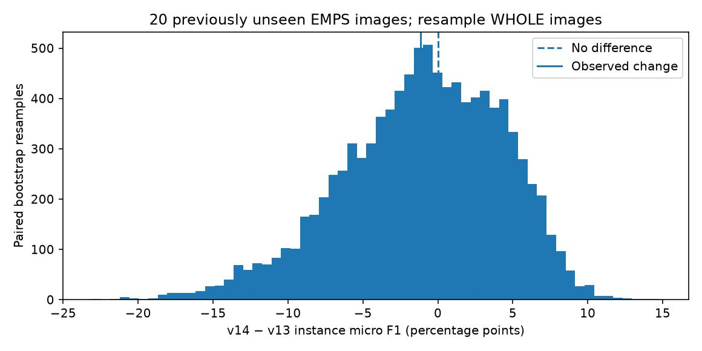
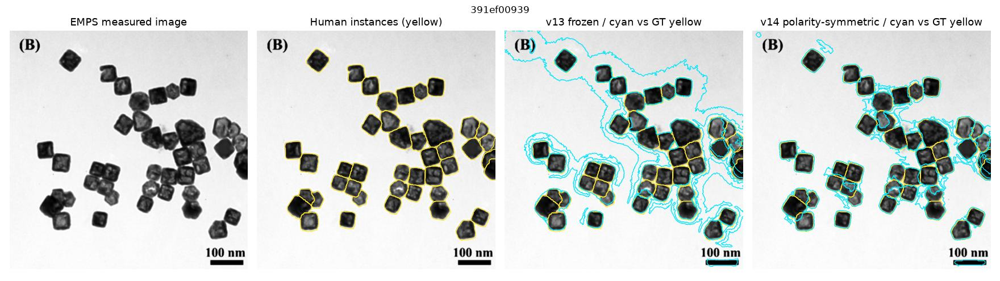

# v14 — 20画像の差の不確実性（ペア・ブートストラップ）

> **探索的な記述統計。** 新規20枚のテスト画像を単位に、1万回ペアで復元抽出。画像内の数百粒子を独立サンプルとして扱わない。

|指標|値|
|---|---:|
|実測micro F1差（v14−v13）|-1.14 ポイント|
|95% percentile区間|-12.89 ～ +7.79 ポイント|
|新規評価画像|20 枚|
|ブートストラップ反復|10,000 回（seed=20261030）|

**結論：区間が0を大きくまたぐ。** 採用基準「F1が下がったら標準置換しない」ではNO-GOだが、20枚でv14の一般性能が低いことまで統計的に確定したわけではない。

再標本化で差がプラスになった比率は0.446。これは**モデル改善のベイズ事後確率でも、有意性のp値でもない**。

## 性能の失敗例も確認する

**制限：** EMPSは同一データセット内のTEM/SEM混合。撮影セッションや機種間の依存性を考慮していないため、この区間は研究室間の外挿に使えない。ユーザーが実際に測りたいPtナノ粒子DM3に対する誤差ではない。

[再現スクリプト](../../scripts/v14_bootstrap_uncertainty.py) / [元のv14評価](REPORT.md) / [全件数値](results/bootstrap_ci.json)
