# TEM粒径解析 v4 — 過剰除外の改善・粒子中心再検出・採否の可視化

**[次の段階：v5目視監査・優先確認キューと判定GUI](../v5/REPORT.md)**


> 2026-10-28 / 研究用プロトタイプ。**実測TEMの人手インスタンス正解は未作成**。このレポートの「採用数増加」は正解率・再現率の向上を意味しません。模擬データの精度と実験画像の探索結果を区別します。

[統合レポート（v1〜v3.1）](../../docs/RESEARCH_REPORT.md) · [ソース（v4）](tem_v4.py) · [ベンチマークコード](evaluate_holdout.py)

## 1. 6視野の採否をすべて画像で確認

色：**緑＝孤立粒子を採用、シアン＝接触分離を採用、紫＝密集塊から再分離して条件付き採用、橙＝要確認、赤＝除外**。橙は粒径ヒストグラム・CSV採用集計に含めません。


### 特に困難な高密度Ptの拡大


## 2. v3.1 と v4 の集計

| 視野 | v3.1採用 | v4採用 | 内訳：孤立 / 接触 / 再分離 | v4要確認 | v4除外 | スケール状態 |
|---|---:|---:|---|---:|---:|---|
| Pt-1: high density | 34 | **192** | 110 / 3 / 79 | 916 | 74 | review_required |
| Pt-2: medium density | 346 | **498** | 346 / 51 / 101 | 88 | 23 | accepted |
| Pt-3: medium density | 186 | **350** | 243 / 29 / 78 | 118 | 27 | accepted |
| Ag-1: isolated | 49 | **51** | 51 / 0 / 0 | 0 | 5 | accepted |
| Ag-2: noisy background | 5 | **6** | 6 / 0 / 0 | 1 | 3 | accepted |
| Ag-3: slight contacts | 12 | **13** | 8 / 5 / 0 | 0 | 2 | accepted |

**重要：v4は大きな連結領域を多数の候補に分割するため、候補総数そのものがv3と異なります。** 候補の採用率をバージョン間で単純比較できません。高密度Ptは34→192個の自動採用になりましたが、さらに916候補は**未採用・要確認**です。現段階で完全自動化の達成とは主張しません。

## 3. 解析画像：v3.1とv4の比較

### Pt-1: high density
**v3.1**（旧版、採用34）
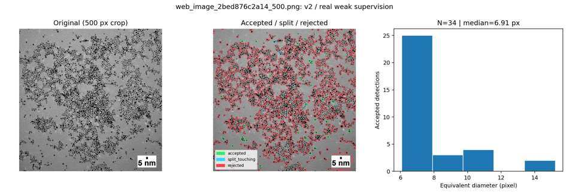
**v4**（新しい採否理由、採用192・要確認916）
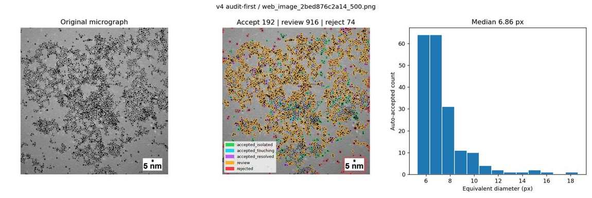

### Pt-2: medium density
**v3.1**（旧版、採用346）
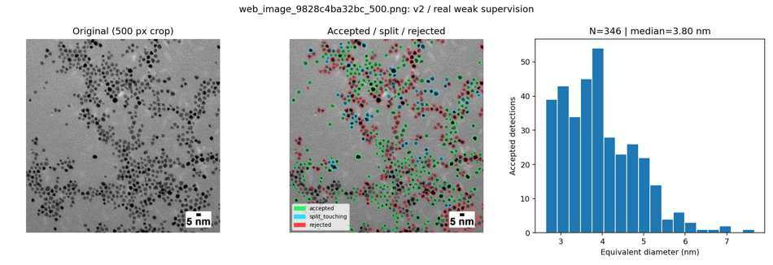
**v4**（新しい採否理由、採用498・要確認88）
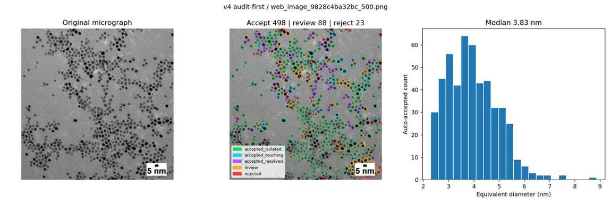

### Pt-3: medium density
**v3.1**（旧版、採用186）
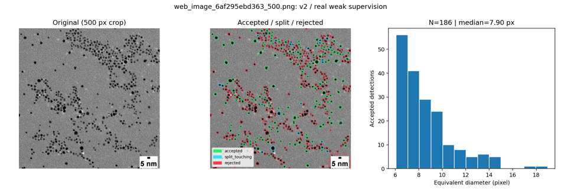
**v4**（新しい採否理由、採用350・要確認118）
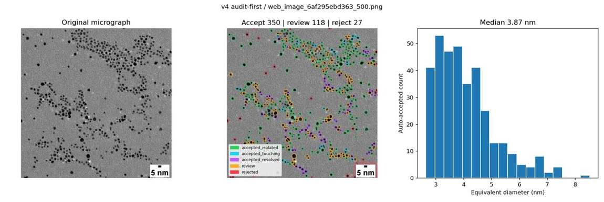

### Ag-1: isolated
**v3.1**（旧版、採用49）
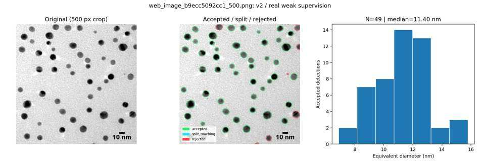
**v4**（新しい採否理由、採用51・要確認0）
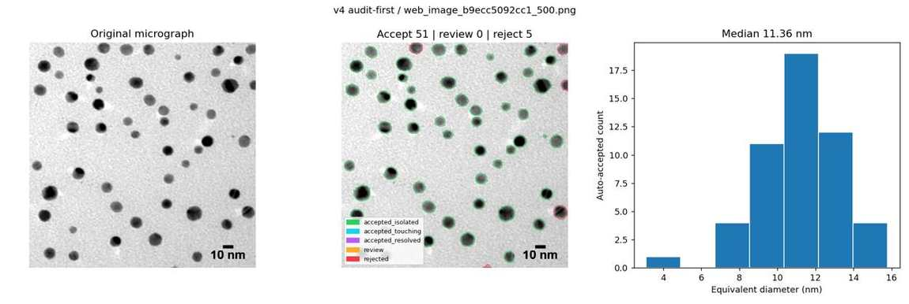

### Ag-2: noisy background
**v3.1**（旧版、採用5）
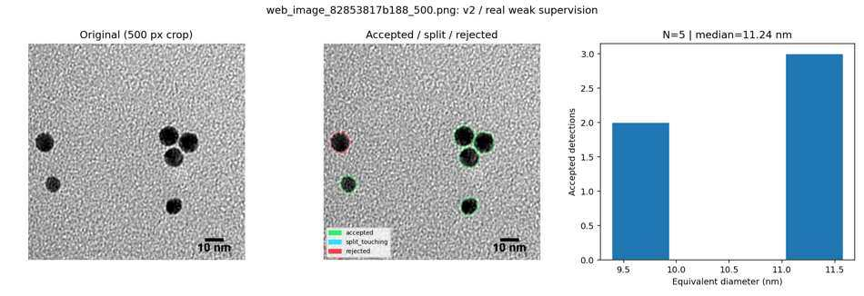
**v4**（新しい採否理由、採用6・要確認1）
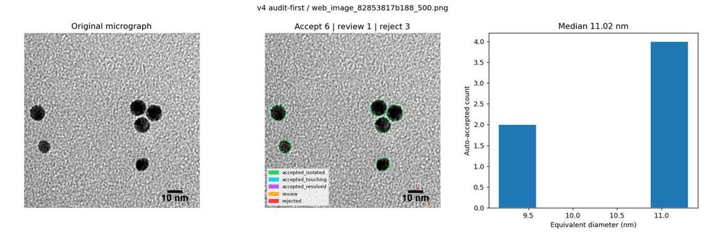

### Ag-3: slight contacts
**v3.1**（旧版、採用12）
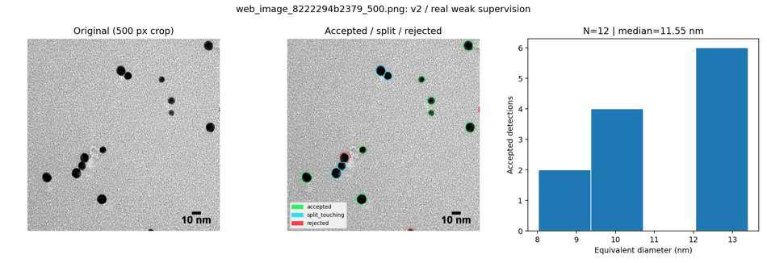
**v4**（新しい採否理由、採用13・要確認0）
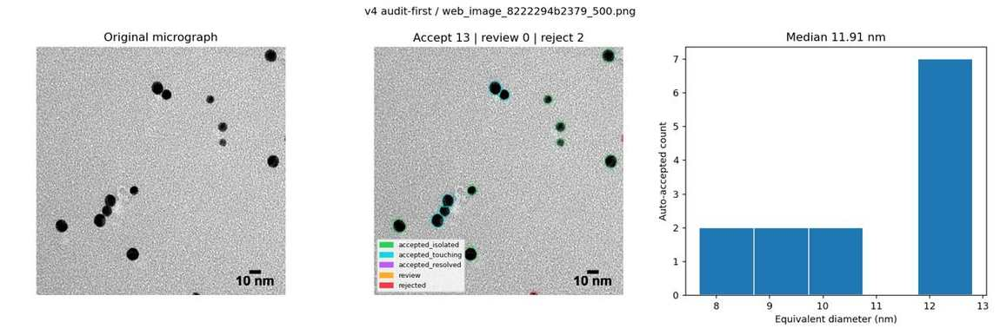

## 4. アルゴリズムの変更点

1. **画像ごとに孤立粒子の代表直径を推定。** LoG/局所暗点を一律3 pxで分割しない。これにより大きなAg単粒子内部の濃淡を複数粒子と誤認しにくくなった。
2. **不足分割の再探索。** 十分大きく、凹凸・細長さのある連結領域に限り、局所暗点の中心を追加し、マーカー制御Watershedを再実行。
3. **強制除外より「要確認」。** 境界が不確かな粒子は橙で保持してレビューCSVへ出す。従来の非円形・凹形状だけで大量除外する規則を置き換える。
4. **再分離粒子は厳しい採用条件。** 円形度≥0.80、solidity≥0.89、長短軸比≤1.4、SNR≥2、画素分類確率≥0.77、隣接中心距離/直径≥0.80、隣接粒子間の明るい谷≥0.05、かつ径が孤立粒子代表径の1.7倍以下に限り紫で採用。それ以外は橙のレビューへ。**この判定は真の重なりなしを保証しない**。
5. **nm換算はv3の機能を保持。** OCRでスケール値を読みバー長を測定、元画像1000px→解析500pxの比率を転送する。バーの短いPt-1は物理単位を保留し、pxのみを出力。

採否の内訳や除外理由、中心座標、局所コントラスト、モデル確率、隣接中心距離、明るさ谷の深さは `particles_all.csv` に保持。**「要確認」は測定値の集計から除く。**

## 5. 独立した模擬TEM4枚に対する退行テスト

学習に使用していない**人工生成TEM**4枚の合成中心328点について、ハンガリアン割当で最大 `max(4.5 px, 0.75×生成半径)` 内の予測中心と1対1対応させた。これは実像精度の検証ではなく、**模擬生成方式での中心検出の退行テスト**。

| 指標 | v3.1 | v4 |
|---|---:|---:|
| 対応する中心 | 171/328 | **172/328** |
| この条件でのPrecision | 1.000 | 1.000 |
| この条件でのRecall | 0.521 | 0.524 |

模擬画像の真の中心には、重なりで画像から見えない粒子も含まれる。中心照合はインスタンス輪郭精度を測っていない。v4の改良による有意な性能改善を主張できるデータではない。

## 6. データ来歴・再現方法・限界

- Ptの3画像：[nanoComposix 5 nm Platinum Nanoparticles](https://nanocomposix.com/products/5-nm-platinum-nanoparticles)。Agの3画像：[nanoComposix 10 nm Silver Nanospheres](https://nanocomposix.com/products/10-nm-silver-nanospheres)。メーカーの図の二次利用・再配布権を保証しない。元データは出典先を参照。
- **v2/3/4モデルは模擬16枚+実画像3枚の弱教師データで訓練した15本のExtraTrees軽量モデル**を使用。Pt-2、Ag-1、Ag-2の3視野は学習にも含まれるので独立評価ではない。
- 実画像の判定結果には独立した人手正解マスクがない。自動的な精度改善は未証明。今後はPt-1の一部を専門家が孤立/接触/重なり/非粒子とラベルし、採用し過ぎ・除外し過ぎを同時評価する必要がある。
- v4が行うのは**再判定・追加の中心分離**で、独立した新しい教師ありインスタンス学習ではない。スケールバーOCRは右下以外を網羅していない。

### 再現コマンド

```bash
pip install -r requirements.txt
pip install pytesseract  # OCRでは別途OS側にtesseractが必要
python v4/tem_v4.py --image path/to/tem_500.png \
   --scale-reference path/to/same_field_1000.png \
   --model v2/model_rf_real_weak_portable.joblib \
   --out v4/results/my_test
python v4/evaluate_holdout.py  # 模擬4枚：追加モデル学習を要求しない
```

最終成果物はGitHubの本レポートと、再現可能なコード。ZIPは配布しない。
