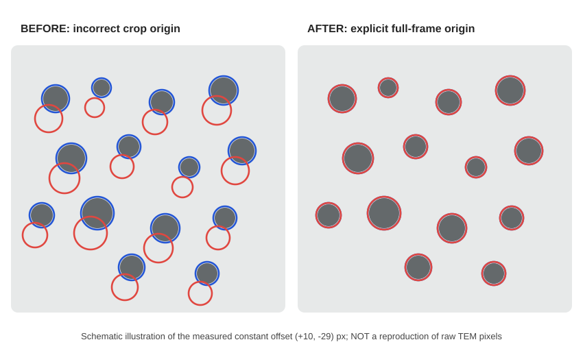

# v7 — TEM輪郭の固定座標ずれ：診断と座標処理の修正

> **実測画像の赤/青二重輪郭の位置ずれを検査。** 重要：掲載写真はユーザー提供のJPEGスクリーンショット。元の青・赤マスクや生成スクリプトは添付されていないため、原因となった具体的な行番号は特定できていない。診断結果と、現行リポジトリの描画経路に適用した対策を区別する。

## 1. 観測された問題

ユーザーからのJPEGスクリーンショットを画素解析した。下図は測定したずれ量を説明する**模式図**であり、原JPEGの画素ではない。JPEG自体はこのレポートに複製していない。



ほぼ全ての青い輪郭が暗い粒子に沿うのに、赤い輪郭が一定の距離だけ下・左へずれている。画像をHSV色空間に変換して赤と青の輪郭画素を抽出し、2値相互相関で相対位置を測定した。

| 指標 | 実測値 |
|---|---:|
| JPEG画像解像度 | 1529 × 1536 px |
| 赤輪郭を青輪郭に重ねる並進 | **x=+10 px、y=−29 px** |
| 左上 / 右上 | (+9,−29) / (+9,−29) px |
| 左下 / 右下 | (+10,−28) / (+10,−28) px |
| 赤輪郭画素が青輪郭の±2px以内にある割合：補正前 | 2.0% |
| 同上：補正後 | 94.8% |

この一致は**固定のROI原点、crop、padding、あるいは別画像座標系を混ぜたエラー**と整合する。縮尺変換だけによるずれや、粒子認識精度だけの問題とは考えにくい。ただし、JPEGだけからどのコード行が誤っているかは確定できない。

## 2. 診断用の画像

スクリーンショットの色輪郭を抽出して行った診断では、赤を(+10, −29) pxだけ移すと青輪郭への±2 px一致率が94.8%になった。**同じ処理を再実行するためのコード**：[`diagnose_overlay_shift.py`](diagnose_overlay_shift.py)。画像を入力すると `alignment_before_after.jpg` と `alignment_diagnostic.json` を生成する。GitHub内では上の座標模式図を表示する。

**右図は表示上の位置合わせのみ**。JPEGから一度描かれた輪郭を色で抽出し、背景を補間して重ね直したもので、元の教師マスク・予測マスク・粒径計測を修復したわけではない。正解データに予測マスクを自動位置合わせすると実際のモデル誤差を隠してしまうため、そのような操作は採用しない。

## 3. コードに実装した対策

[共通の描画座標ライブラリ](../../contour_coordinates.py) の `MaskROI` は、各マスクに次の情報を必須にする。

- `pixels`（二値画像）
- `origin_xy=(x0, y0)`（元画像上の**左上原点**、行列インデックスではなくx,y）
- `shape_hw=(height,width)`（元画像の寸法）
- `source_key`（どの撮影視野かを識別）

```python
# ROI-local mask cannot be placed at (0,0) by accident.
full = MaskROI(pixels=local_mask,
               origin_xy=(crop_left, crop_top),
               shape_hw=original_rgb.shape[:2],
               source_key=image_id).to_full(
                  expected_key=image_id,
                  expected_shape_hw=original_rgb.shape[:2])
```

描画する前に元画像座標へ戻し、ROIが画像外に出る、元画像寸法が違う、source_keyが一致しない場合は例外で停止する。**任意の+10/−29 pxの補正をコードにハードコードしていない。**

既存の `v2/tem_v2.py` と `v4/tem_v4.py` のROI輪郭描画もこの共通関数に統一した。両コードは従来から局所原点を加算する処理を持っていたため、**今回のユーザー画像の出力元だと証明されたわけではない**。目的は今後の座標変換ミスを一箇所で防ぐこと。

## 4. 回帰テスト

`python -m unittest v7/test_contour_coordinates.py -v` → **6件PASS**。

1. 非ゼロcrop originを与えたROIが原画像の正しい座標に描画される。
2. 同じ原画像に属する2つのマスクは同じ位置に表示される。
3. 異なる撮影視野のマスクを混ぜると停止する。
4. ROIが原画像の外へはみ出せば停止する。
5. マスクが想定する元画像寸法が違えば停止する。
6. 人工的に (−10,+29) pxずらした赤輪郭を(+10,−29) pxとして検出する。

加えてユーザー提供JPEGの診断値は[JSON](results/alignment_diagnostic.json)に保存した。

## 5. 残っている確認

**実際の赤/青二重輪郭の生成元は、このリポジトリのv2/v4標準出力には見当たらなかった。** 同じ二重輪郭図を生成したスクリプト・元の2マスクが入手できれば、その実際の描画経路のROI原点を追跡し、データまで整合した再レンダリングで検証できる。出所不明のまま画像の描画位置だけを移して「原プログラムのバグ修正完了」とは判定しない。

### GitHub上の修正コード

- [原画像座標へ変換する共通ライブラリ](../../contour_coordinates.py)
- [v2の輪郭描画（共通化済み）](../v2/tem_v2.py)
- [v4の輪郭描画（共通化済み）](../v4/tem_v4.py)
- [6件の自動テスト](test_contour_coordinates.py)
- [CIワークフロー](../../.github/workflows/contour-coordinate-regression.yml)
