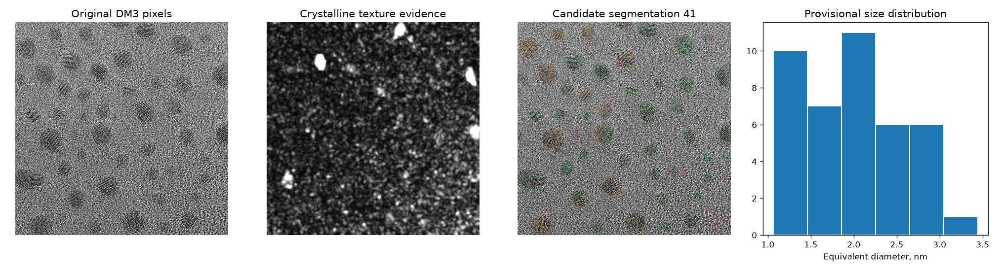
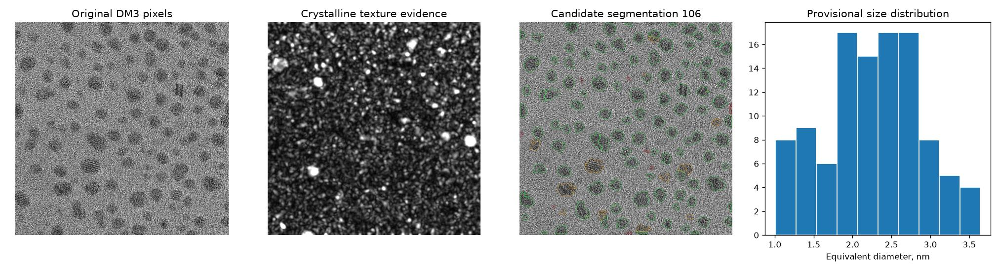

# v9 — HRTEM精度改善：人手正解マスクとの直接比較

> 実験TEMでの精度は **独立した人手正解と比較した場合だけ** 報告。人工データや採用数の増減を精度の証拠にしない。

## 研究データ

- 従来v8では公開ANTEMA DM3のHRTEM粒子領域抽出は探索的で、独立ラベルはなかった。
- 新たに **LBNL/Sytwu et al. のDryad HRTEMマスク**を独立評価に採用：
  [10.7941/D1SP93](https://doi.org/10.7941/D1SP93)。Au 5 nmの画像と人手マスクのHDF5をCIで外部取得する。
- v8：Gabor結晶周期性＋暗部エンベロープ。v9候補：より強い結晶周期性条件に加え、細長い擬似粒子・画像端候補を保守的に除外。
- **v9の後処理条件はこの人手GTに合わせて最適化していない。**
- 人手GTは同一のHDF5から取得、画像/マスク配列のサイズが違えばエラー停止。

## 旧版の実DM3での課題

**注意：** 上記のv8採用数41/106および粒径中央値はGT未照合であり、精度が確認された値ではない。

## 人手マスクに対する独立評価

**未検証：CIで独立マスク評価が完了していない。実画像のDice・IoU改善はまだ主張しない。**
公開データ取得：\`failure\` / 評価：\`skipped\`。
Dryad側のアクセス制限やHDF5フォーマットに問題があれば、そのまま失敗を記録する。

## 再現方法

- [精度評価コード](real_gt_benchmark.py)：HDF5を読み、GTと同じ座標で2方式の輪郭を比較。
- [GitHub Actions（公開HDF5取得と解析）](../../.github/workflows/v9-human-gt.yml)。
- 元HDF5は巨大なためGitHubでは再配布せず、派生した図・計算値・出典を記録。
- **人手GTは1人のアノテータによるラベル**であり、顕微鏡の真の立体的粒子境界とは限らない。
- 今後の課題：大径/小径・接触粒子の層別指標、異なる撮影セッションでの再検証、過剰除外の定量評価。
