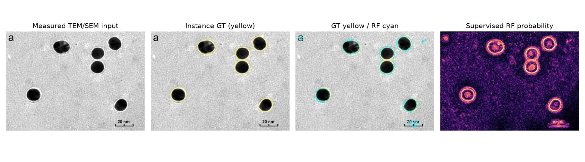

# v11 — 粒子分割の過剰結合を、教師あり検証で改善する

> **EMPS実測画像・粒子別IDラベルの学習/評価。テスト画像に閾値を合わせ込まない。**

## 目的と試験設計

- v10では粒子領域Dice **0.765** に対し、Watershed分割後の粒子単位Recallが **0.223** と低かった（公式test 8画像のmacro平均）。
- v11では**RFの特徴量と学習画像を同じまま**にし、別の公式train画像6枚を検証用に確保して、二値化しきい値とWatershed中心間隔を選ぶ。
- 学習28画像と検証6画像は別。公式test 8画像を使ったチューニングは禁止。
- 分割候補の評価には、粒子ID付き人手GTとの**IoU ≥ 0.5 の1対1対応**を用いる。
- 実測元データは[EMPS（Yildirim & Cole 2021）](https://github.com/by256/emps)の公式分割。MITライセンス。

公開データ取得：`not_run` / 評価：`not_run`。

**独立テストの結果は未取得。** 指標・改善率は報告しない。

## 前段階で取得した実測画像の解析図



## 限界と次の実装

- EMPSはTEM/SEM混合。HRTEM（格子縞）の精度と同一視できない。
- EMPSは外部の粒子別マスク。輪郭を境界として扱うが、原子レベルの「真の」粒径を保証しない。
- スケールはメタデータ照合していないので実長ではなくpx。
- 公式test 8画像は初回評価から再使用している。今後の新規モデル選択には別セッションの未知画像が必要。
- 改善が不十分なら中心検出にも教師ありモデルを導入し、Watershedの中心不足を直接解決する。

## 再現

```bash
pip install -r requirements.txt
PYTHONPATH=v11 python -m unittest discover -s v11 -p "test_v11.py"
python v11/tune_instances.py --dataset-root /path/to/emps --out v11/results
python v11/build_report.py
```

[実装](tune_instances.py) / [単体テスト](test_v11.py) / [GitHub Actions](../.github/workflows/v11-emps.yml) / [前回v10レポート](../v10/REPORT.md)
