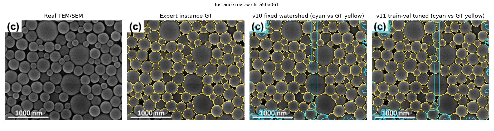

# v12 — 粒子中心の教師あり検出で接触粒子を分割

> **この段階の新規性：粒子/背景だけでなく、粒子IDの人手GTから中心位置も学習。** EMPS公式train/testを厳密に分離する。

## 構成

- 従来：多尺度Random Forestで粒子領域を学習 → 距離変換ピーク → Watershed。
- v12：同じ領域モデル + **別のRandom Forestで粒子中心候補の確率を学習** → 検証セットで選んだ中心閾値をWatershedのマーカーに使用。
- 粒子中心教師ラベルは、公式trainにある個々のインスタンス重心の周辺のみを陽性とする。
- train28画像で領域RFと中心RFを学習、別の公式train6画像でマーカーパラメータを選択。テスト8画像は一切閾値探索に使わない。
- 対象：公開[EMPS instance segmentation](https://github.com/by256/emps)（TEM/SEM混合、MITライセンス）。

実測データ取得：`not_run`、評価：`not_run`。

**まだ実測の独立テスト値を取得できていない。数値を捏造しない。**

## 限界

- 元のGTは粒子投影像のアノテーションであり、物理的に重なった粒子は不確定。
- 今回は画像を512 px以下へ縮小しているため、nm単位の検量は行わず粒径誤差はpx単位。
- EMPSにはSEMも含まれる。v8のHRTEM-DM3での汎化は別途検証が必要。
- 既存test8画像の再利用により追加モデル選択を繰り返すとテストセットへの過適合リスクがある。今後のGo/No-Goには未知撮影セッションが必要。

## GitHub再現

[中心学習・分割コード](center_model.py) / [単体テスト](test_v12.py) / [再実行ワークフロー](../.github/workflows/v12-emps.yml) / [v11レポート](../v11/REPORT.md)
