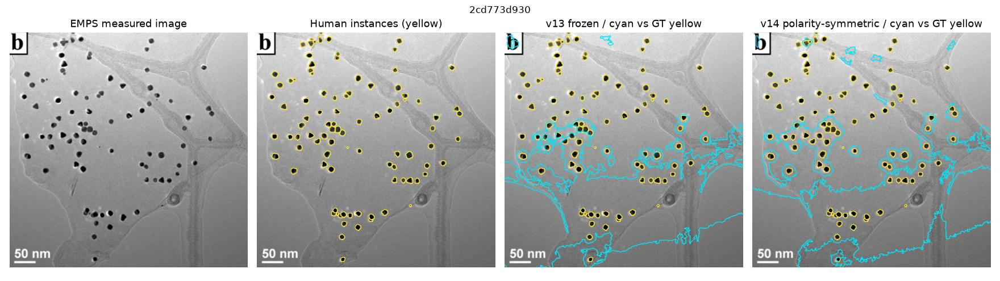
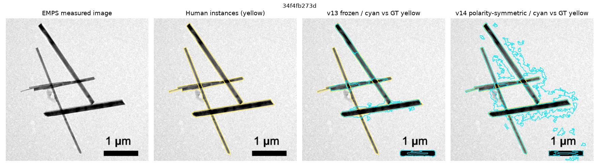
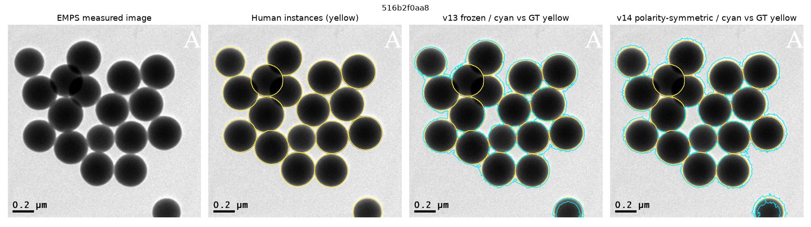

# v14 — 反転対称の教師あり粒子分割：過去8枚を除いた新しい20枚で評価

> **ステータス：新規テスト20枚はEMPSの公式testから選択。v10〜v13で使った8枚は除外。** EMPSにはTEM/SEMが混在し、これはDM3/HRTEMの独立外部評価ではありません。

## 評価設計

- v13は既存コードの実装・訓練選択と事前固定パラメータ（semantic .52, border .35, area 45 px², erosion 1）を保持。
- v14は同じ公式train画像28枚の各画像と輝度反転画像をペア学習し、推論でも通常像と反転像の予測確率を平均する。**入力反転に厳密に対称**。
- 過去に繰り返し評価した8枚を除外し、固定seed=20261114で残りの公式test画像から20枚選出。評価マスクは学習・閾値調整に使用しない。
- 粒子一致は人手インスタンスマスクとの1対1マッチング（IoU≥0.5）、微平均F1を主指標とし、TP/FP/FN・画素径MAEも保存。
- 粒子の**明／暗**は正解マスクを使って*評価後に層別表示するだけ*。予測アルゴリズムには渡さない。
- 注意：以前のテスト8枚の失敗に着想を得た改良なので、完全なプロジェクト外データセットでの検証ではない。

CI状態：取得 `success`、評価 `success`。

[**差の不確実性：20画像単位のペア・ブートストラップ（図入り）**](UNCERTAINTY.md)：F1差 −1.14ポイント、95%区間 −12.89〜+7.79ポイント。一般的な優劣はまだ不確か。

## 未使用テスト20枚の結果

| 指標 | v13（固定） | v14（明暗対称） |
|---|---:|---:|
| TP | 237 | 245 |
| FP | 626 | 738 |
| FN | 499 | 491 |
| Micro F1 | 29.64% | 28.50% |
| Precision | 27.46% | 24.92% |
| Recall | 32.20% | 33.29% |
| 対応粒子の直径MAE（画像別平均、px） | 5.537405017302545 | 4.843439117076706 |

**判定：この20枚ではF1低下。標準モデルを更新しない（NO-GO）。**

### 粒子の極性別（評価後の層別のみ）

|極性|視野数|v13 F1|v14 F1|
|---|---:|---:|---:|
|bright|7|36.78%|42.95%|
|dark|13|26.55%|22.99%|

### 全視野別のTP/FP/FN

|ID|明暗|GT粒子数|v13 TP|v14 TP|v14 FP|v14 FN|
|---|---|---:|---:|---:|---:|---:|
| `2cd773d930` | dark | 94 | 0 | 0 | 22 | 93 |
| `2fb8fe344c` | dark | 1 | 1 | 1 | 9 | 0 |
| `34f4fb273d` | dark | 4 | 1 | 2 | 38 | 2 |
| `391ef00939` | dark | 43 | 12 | 23 | 28 | 20 |
| `3d103080e6` | dark | 9 | 3 | 1 | 11 | 8 |
| `4bafa92eec` | dark | 12 | 4 | 6 | 24 | 6 |
| `516b2f0aa8` | dark | 18 | 1 | 1 | 11 | 17 |
| `5a25d179cc` | bright | 4 | 4 | 4 | 51 | 0 |
| `84a6330bdb` | bright | 63 | 53 | 50 | 78 | 13 |
| `87429394b0` | bright | 8 | 3 | 8 | 3 | 0 |
| `8c22d1acd5` | bright | 10 | 9 | 9 | 13 | 1 |
| `90615b870a` | dark | 1 | 1 | 1 | 118 | 0 |
| `a1e18db01a` | bright | 8 | 6 | 6 | 37 | 2 |
| `a2883fc6eb` | dark | 65 | 44 | 10 | 123 | 55 |
| `c0ba8a65a5` | bright | 5 | 4 | 4 | 17 | 1 |
| `d83980d44e` | dark | 80 | 38 | 55 | 47 | 25 |
| `ddffc403e3` | bright | 35 | 10 | 21 | 41 | 14 |
| `e493a405ad` | dark | 234 | 0 | 1 | 2 | 230 |
| `e7187b91bf` | dark | 1 | 1 | 1 | 15 | 0 |
| `f98c5fb82a` | dark | 45 | 42 | 41 | 50 | 4 |

### 画像：原像・正解輪郭・旧版・新版

黄色が人手インスタンスGT、シアンが推定輪郭。比較には**同じ画像・同じ座標**を使う。

[数値の全件記録](results/metrics.json) / [各視野CSV](results/per_image.csv)

## 限界・次の優先課題

- 明暗の極性が局所的に反転するHRTEM・多相粒子は、単純な全画像反転と同等ではない。
- IoU≥0.5の粒子対応に失敗した粒子の径誤差はMAEに含まれない。必ずF1と合わせて読む。
- EMPSはTEM/SEM混合。撮影セッションやメーカーが独立したDM3データでの再試験を別途要する。
- 新20枚の性能が高くても、最初の8枚での反復開発によるモデル設計の間接的過適合に注意。

[モデル・評価コード](polarity_benchmark.py) / [回帰テスト](test_v14.py) / [GitHub Actions](../.github/workflows/v14-polarity-benchmark.yml) / [過去のv13レポート](../v13/REPORT.md)
