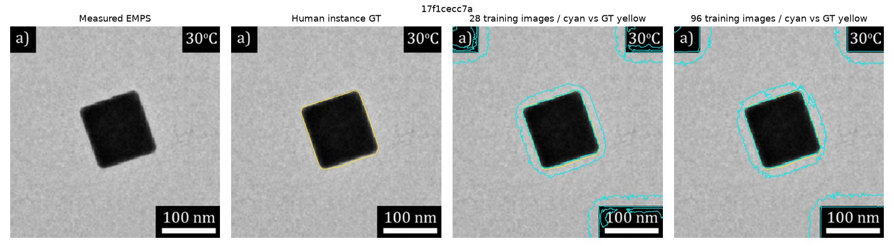
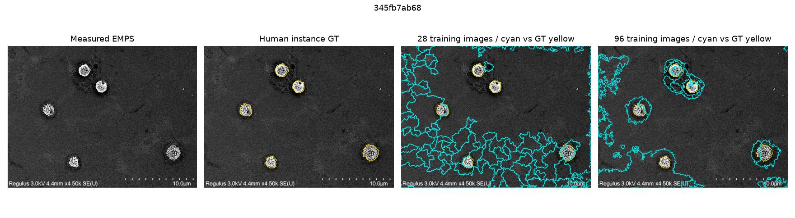
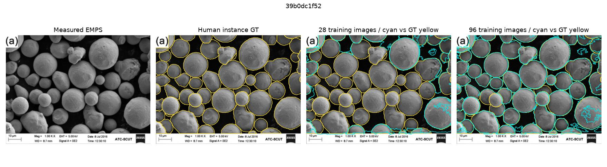
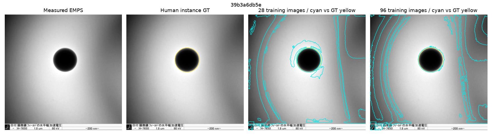

# v15 — 教師データ増量は粒子単位精度を改善するか？

> v13と同じ画像処理・後処理・閾値を保持したまま、公式EMPS trainの教師画像を28→96枚へ増やした試験。
> **検証にはv10〜v14の既使用28枚を除いた新しい公式test20枚を一度だけ使用。** EMPSはTEM/SEM混合でDM3 HRTEM独立評価ではない。

## 実験設計

- v13：train画像28枚、RF＋境界ExtraTrees。v15：train画像96枚（v13の28枚をすべて含み、公式trainから68枚追加）、同じアルゴリズム・特徴・学習ハイパーパラメータ。
- 後処理はv13のtrain validationで決まった閾値（core=0.52、boundary=0.35、seed area=45、erosion=1）で凍結。
- v13の28枚の学習対象IDを既存metricsと照合、testからtrainへの画像混入を拒否。
- v14の新20枚＋以前の8枚を除外した次の20枚を固定乱数で選出。**正解マスクは最後の評価と層別だけ**。
- 主指標：人手インスタンスマスクとIoU≥0.5で1対1対応した粒子単位micro F1。

CI取得：`success`、計算：`success`。

## 未使用20枚での実測結果

|指標|v13（28枚で学習）|v15（96枚で学習）|
|---|---:|---:|
|TP|115|139|
|FP|622|406|
|FN|142|118|
|micro F1|23.14%|34.66%|
|Precision|15.60%|25.50%|
|Recall|44.75%|54.09%|
|対応粒子の径MAE（px、対応あり画像の平均）|6.279072386893244|4.137237901176726|

**判定：この20枚ではF1向上。追加外部検証の候補。ただし既定モデル置換は保留。**

### 明暗別の検証（GTから事後分類）

|極性|v13 F1|v15 F1|
|---|---:|---:|
|bright|25.23%|36.55%|
|dark|21.34%|32.56%|
|low_contrast|13.64%|24.00%|

### 粒子輪郭付きの実画像比較

黄色=人手GT、シアン=モデル予測輪郭。

[数値詳細JSON](results/metrics.json) / [視野別CSV](results/per_image.csv)

## 注意

- v10〜v14の評価を見てから教師増量を選んでいるため、この新20枚も完全に独立した外部データセットではない。
- 多種のTEM/SEM粒子を含むEMPSのスコアを、実DM3/HRTEMやPt粒子の精度として流用しない。
- 評価成功後も、未対応粒子の径はMAEに含めない。Precision/Recallを併記する。

[評価コード](data_scale_benchmark.py) / [回帰テスト](test_v15.py) / [GitHub Actions](../.github/workflows/v15-data-scale.yml) / [v14明暗反転の検証](../v14/REPORT.md)
