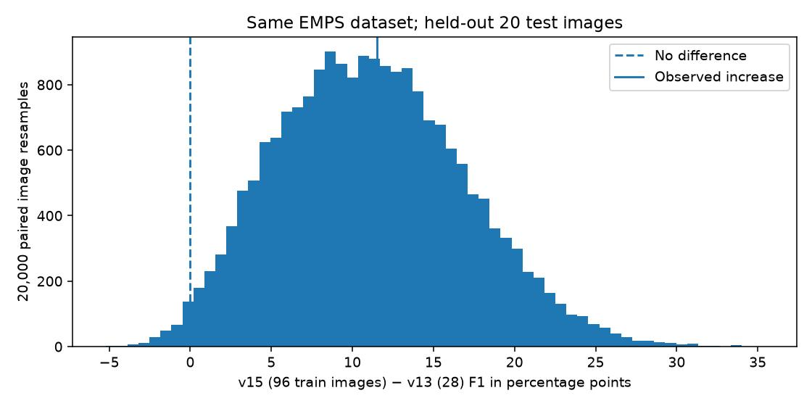

# v15 — 教師96枚の改善幅：画像単位の不確実性

> 実測テスト20視野を単位とするペア・ブートストラップ20,000回。粒子を独立の標本として扱わない。

| 項目 | 数値 |
|---|---:|
| 観測したmicro F1改善 | +11.52ポイント |
| 95% percentile区間 | +0.92 ～ +23.01ポイント |
| 画像単位復元抽出 | 20,000回、seed 20261115 |

**解釈：** この20視野ではF1改善が見られ、今回の再標本化区間も0を上回った。ただしEMPSの撮影条件間の相関と、v10〜v14での探索歴は扱えていない。

再標本化で差がプラスだった割合は 0.987。これはp値でも、他装置での改善確率でもない。

**注意：** 評価単位は2Dマスクであり、粒径MAEはIoU≥0.5で対応できた粒子のみを対象とする。真のサイズ誤差と混同しない。

[本体レポート](REPORT.md) / [保存した各視野データ](results/metrics.json) / [再現コード](../scripts/v15_paired_uncertainty.py)
