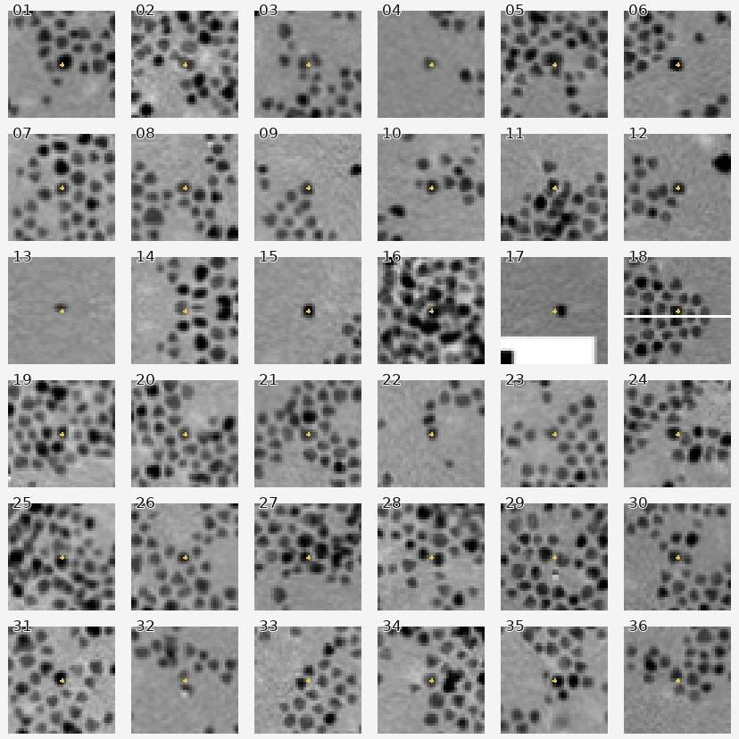
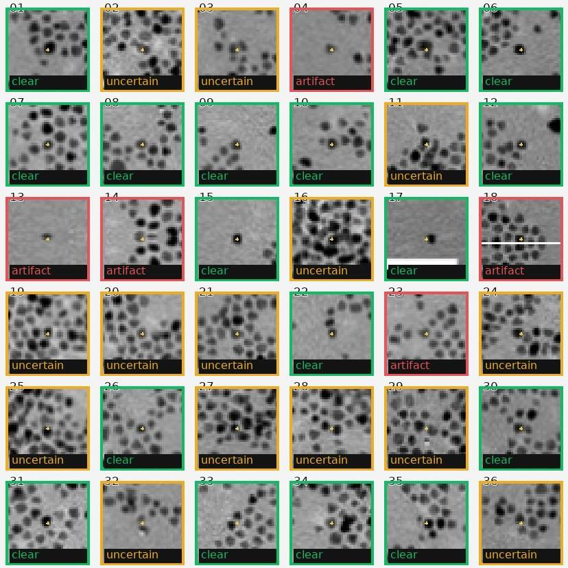

> **後続の独立監査手順：** [v6 ブラインド60候補・2名レビューの研究レポート](../v6/REPORT.md)。以下の36候補はAIによる補助監査で、専門家による正解データではありません。

# v5 — 高密度Ptの過剰除外を検証する目視監査と再審査キュー

> 2026-10-29 / **STATUS: research pilot; NOT expert-labelled benchmark**  
> 目標：**「除外が多すぎる」問題を、採用数の水増しをせず検証し、採否を人が確定できる状態にする。**  
> ⚠️ このページの目視スポットチェックは**AIアシスタントによる1回の補助判定**であり、顕微鏡画像解析の専門家による独立した正解ラベルではありません。粒径計測精度、precision、recallの証明には使えません。

## 1. 先に結論

- 既存のv4公開レポートでは、高密度Pt-1は **自動採用192 / 要確認916 / 除外74**。これはそのときの元画像・モデル・処理条件による結果。
- その後の監査では、元TEM画像が手元にないため、以前保存したv2レポートの**左側の「原画像表示パネル」から画像を復元**して同じ視野を再処理した。こちらは **自動採用205 / 要確認783 / 除外63**。表示パネルの再サンプリングと圧縮があるので、**元のv4と厳密には比較できない**。
- 目視の補助スポットチェックでは、**要確認18候補中7候補は単粒子として測定できそう**に見えた。一方、**採用済み12候補のうち1候補は背景らしく見えた**。よって単純な採用閾値の緩和ではなく、両方向（偽除外・偽採用）の確認が必要。
- 要確認783候補を、LoGの別法による中心検出と形状・濃淡に基づいて **high=122 / medium=503 / low=158** の**優先確認キュー**へ振り分けた。**highは自動採用ではない。**
- さらに「除外」63候補のうち10候補を、中心検出で裏付けのある**再審査対象**として抽出した。元の除外判定は保持する。
- 実際に人が1件ずつ「採用・除外・不明」を記録し、**モデルの元判定と手動確認済みの判定を別々に保存**するGUI・CSV出力を実装した。

## 2. 監査対象と出典

**対象**：[nanoComposix, 5 nm Platinum Nanoparticles](https://nanocomposix.com/products/5-nm-platinum-nanoparticles) に掲載された高密度Pt明視野TEM（以前のPt-1視野）。

**重要な再現性の制約**：元のvendor画像の完全なデータセットを今回の作業環境に取り込めなかったため、すでに保存してあるv2解析画像の左パネルを切り抜き、表示座標から500×500 pxへ再サンプリングして監査した。これは**説明用の近似的な画像復元**であり、元JPEGや顕微鏡の16-bit TIFFではない。元のv4の候補ID・採用数と本実験のIDは対応していない。以下の数量は、必ずこの制約付きで解釈する。


**スケール換算**：Pt-1の短い5 nmバーは以前のv3から `review_required`。監査では強制的に実長へ変換せず、**px単位**で出力した。メーカーの公称5 nmはモデルの粒径採用条件に使用していない。

## 3. 採否を隠した36候補の視覚的スポットチェック

### 3.1 ステータスを見ないで候補中心を見る

再推論の候補から、6つの分類群（孤立採用、分離採用、除外、要確認の3種類）について、それぞれ6件ずつ固定乱数シード `11129` で抽出。**候補中心には黄色い十字**を表示したが、最初の判定時にはモデルの採否色を非表示にした。



比較用：**緑=モデル孤立採用、紫=モデル再分離採用、赤=モデル除外、橙=モデル要確認**。


### 3.2 画像だけに基づく補助的な判定

- **clear**：黄色い中心付近に明瞭な単独の暗い粒子らしい構造
- **uncertain**：重なり・接触・境界不明瞭・解像度不足などで判断保留
- **artifact**：中心に独立粒子を確認できない、画像表示アーティファクトの疑い



| 元のモデル判定 | spot-check数 | clear | uncertain | artifact |
|---|---:|---:|---:|---:|
| 採用（孤立＋再分離） | 12 | **8** | 3 | **1** |
| 要確認 | 18 | **7** | 10 | 1 |
| 除外 | 6 | **2** | 1 | 3 |
| **計** | **36** | **17** | **14** | **5** |

この表から言えるのは、**過剰除外だけでなく誤採用の疑いもある**ということ。抽出はステータス層別で、画像内の粒子全体を無作為抽出していない。したがって **7/18を全要確認候補の救済率として外挿したり、8/12をprecisionと呼んではいけない**。モデル候補を中心に切り出した、1人（AIアシスタント）の主観的な予備監査である。

## 4. 新しい優先確認キューとその限界

別法の多尺度 Laplacian of Gaussian（LoG）で暗い中心を検出し、各v4候補との位置一致、円形度・solidity・aspect比、局所コントラスト、面積を点数化。**LoGも画像からのアルゴリズム推定なので、独立した正解ではない。**


| 分類 | 要確認候補数 | 処置 |
|---|---:|---|
| **High** | 122 | 最初に確認（中心と形状の証拠が4条件一致） |
| Medium | 503 | 次に確認（2～3条件一致） |
| Low | 158 | 最後に確認（0～1条件一致） |
| Reconsider rejected | **10** | 元の「除外」を上書きせず、人の再審査に回す |

**ここは「自動採用を増やした」結果ではない**。悪い採用を防ぐため、原則は **モデル採否とレビュー結果を分離して確定する**。前節の36件でもHighが完璧という結果は出ていない。High/Medium/Lowは**確認する順番**であり、検出確率ではない。

## 5. 新機能：粒子単位の目視確認と確定履歴

追加スクリプト：

- [`triage_review.py`](triage_review.py)：v4候補CSVを読み込んで独立LoG支持度・レビュー優先順位を付与する。元のステータスを変更しない。
- [`build_gallery.py`](build_gallery.py)：各モデル状態から固定シードでスポットチェック画像とインデックスを再生成。
- [`app_review.py`](app_review.py)：Gradioで拡大画像を表示し、候補IDごとに **accept / reject / uncertain** を保存する。**画像ハッシュ検証**により違う倍率・違う画像に候補座標が適用されるのを防止。
- [`review_workflow.py`](review_workflow.py)：追加判定CSVを別ファイルに保存し、モデル採用（未確認）と明示的な手動採用を区別して出力する。
- [`test_review_workflow.py`](test_review_workflow.py)：元CSV不変、手動採用/除外の反映、nm換算、無効ID、未確認候補の拒否をテスト。

**原データCSVは変更せず**、`review_decisions.csv` に （operator / 時刻UTC / 理由） を記録。出力では `manually_accepted`、`model_accepted_unconfirmed`、`pending_review`、`manually_rejected` を明示して区別する。`uncertain` を入力した候補は常に粒径統計から除外する。

### 再現・操作例

GitHubでは、外部著作権のある元TEM画像を自動再配布していない。実データを**合法的に入手し、同じ解像度**で用意すること。

```bash
pip install -r requirements.txt
pip install gradio pandas
# v4のモデルと同じ画像から candidates CSV を作る
python v4/tem_v4.py --image data/external/pt_500.png \
  --model v2/model_rf_real_weak_portable.joblib --out results/pt_v4
# v4の全候補へ二重検出に基づく確認優先度を追加
python v5/triage_review.py --image data/external/pt_500.png \
  --candidates results/pt_v4/particles_all.csv --out results/pt_v5
# ブラウザGUIを起動（画像・候補CSV・判定保存先を入力してLoad）
python v5/app_review.py
# 人手レビュー完了後、元CSVを上書きせず統計を再出力
python v5/review_workflow.py apply \
  --candidates results/pt_v5/review_triage_all.csv \
  --decisions results/pt_v5/review_decisions.csv \
  --out results/pt_v5/reviewed
```

**現時点では専門家レビューによる確定粒径CSVは存在しない。** レビューGUIは今後の実データに対して判定者が入力する実用品であり、このレポートの36件の補助ラベルを自動で「専門家が承認した」として読み込むことはしない。

## 6. 何が未解決か / 完了条件

1. **元の高解像度TEM画像での再実行**：今回のレポート画像由来の再構成を、元JPEGや装置生データに置き換える。
2. **専門家による独立したGT**：少なくともPt高密度の層別ROIで粒子中心・接触・真の重なりを付け、保留候補の**再現率と誤採用率を別々に計測**する。
3. **閾値の校正**：画像ごとの固有最適化ではなく、独立した撮影視野で検証する。
4. **nm誤差**：装置メタデータによるスケール検量と、ピクセル端点推定の誤差伝播を明確にする。

**判断：過剰除外が存在する可能性は具体例で示せたが、完全解決とは判定しない。** 今回完成したのは「判断根拠の可視化」「要確認の効率化」「明示的な人手採否と追跡可能な統計出力」。この枠組みを用いて独立GTを作ることが次の計算・実測フェーズ。

[以前のv4全画像レポート](../v4/REPORT.md) ｜ [スケールバー検量の記録](../v2/SCALE_CALIBRATION.md) ｜ [v1〜v3.1統合レポート](../docs/RESEARCH_REPORT.md)