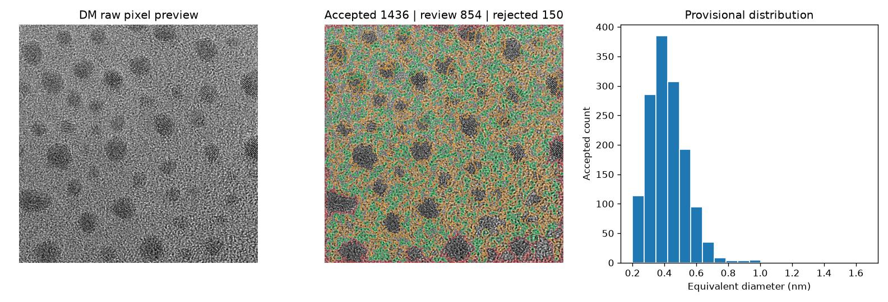
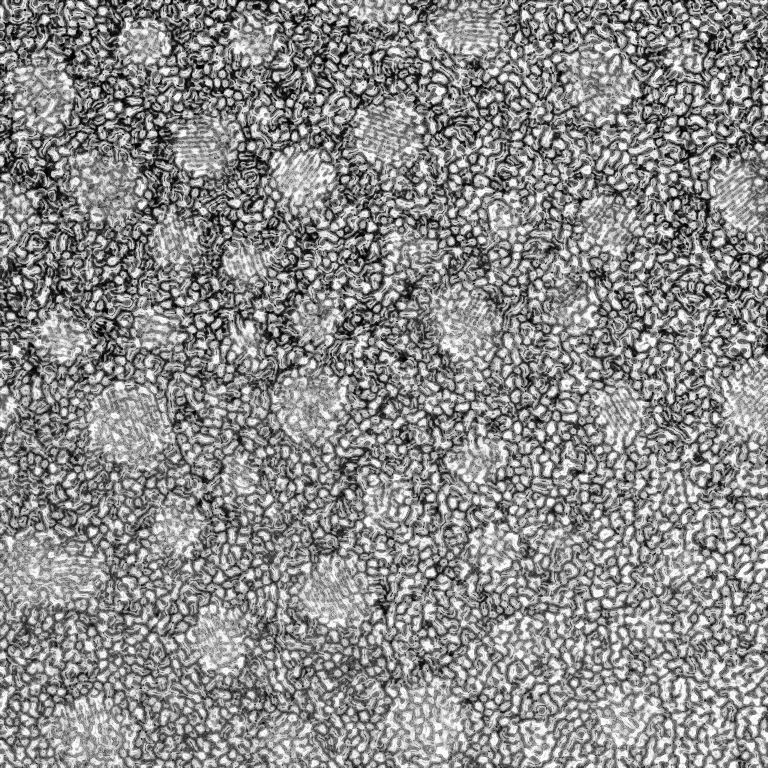
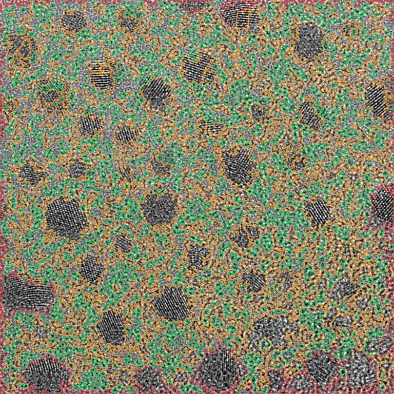
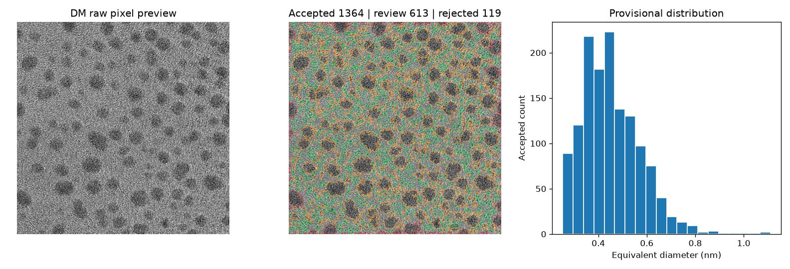

# DM3/DM4生画像対応 — 公開TEM実データ検証

> **実行結果（GitHub Actions生成）**。これは実験TEMからの暫定推論であり、独立正解マスクによる精度検証ではありません。

## 元データと方法

- 公開DM3画像: [Gumbiowski et al. ANTEMA Testimages](https://github.com/ngumb/ANTEMA/tree/main/Testimages)。実DM3は再配布せず、実行時に取得。
- 形式読取: RosettaSciIO / `rsciio.digitalmicrograph.file_reader`。生画素は保存したまま、解析用にロバスト正規化。
- 元のDM3タグにX/Yの実空間校正がある場合のみnmへ変換。無ければpx単位で止める。
- 既存の教師ありRandom Forest（模擬TEM学習）を追加学習なしで適用。**モデルはこのDM3に対して未検証**。
- 輪郭の緑=自動採用、橙=要確認、赤=除外。重なり疑いを自動集計に入れない。
- 画像端の粒子は除外。縮小時はx/yのnm/pxを倍率で再計算。

## 実行一覧

| DM3 file | Original size | Analysis size | Calibration | Accepted | Review | Rejected | Median |
|---|---|---|---|---:|---:|---:|---|
| NP-TEM-Image1 | [1024, 1024] | [768, 768] | calibrated | 1436 | 854 | 150 | 0.40 nm |
| NP-TEM-Image2 | [1024, 1024] | [768, 768] | calibrated | 1364 | 613 | 119 | 0.44 nm |

## 画像別の輪郭と粒径分布

### NP-TEM-Image1








- 元ファイルSHA256: `dabc14ef6dc40d30060d067b148603c08152a2758b9ee8cbc140a2bdfb0cdb87`
- 実寸校正: x=0.051109135150909424 nm/px, y=0.051109135150909424 nm/px; status=calibrated
- [候補全件CSV](results/NP-TEM-Image1/particles_all.csv) / [採用候補CSV](results/NP-TEM-Image1/particles_accepted.csv) / [取得メタデータ](results/NP-TEM-Image1/source_metadata.json)

### NP-TEM-Image2




- 元ファイルSHA256: `9bf9ce564ac96b8874e001916721d6fdf0ce5214778dddb29aba495b6c199b5c`
- 実寸校正: x=0.06464803218841553 nm/px, y=0.06464803218841553 nm/px; status=calibrated
- [候補全件CSV](results/NP-TEM-Image2/particles_all.csv) / [採用候補CSV](results/NP-TEM-Image2/particles_accepted.csv) / [取得メタデータ](results/NP-TEM-Image2/source_metadata.json)

## 信頼性と課題

- **本結果の粒子数・粒径中央値はモデルによる候補推定であり、正解率や実測粒径精度を示さない。**
- DM3内のデータが複数ある場合、解析対象dataset indexを実行ログに明記すること。スペクトルや回折像をナノ粒子像と混同しない。
- 複数フレーム/傾斜系列の3Dデータは必ずフレーム番号を指定する。
- 本番の校正にはDigitalMicrographのタグを独立に確認する。非正方ピクセルでは面積に `sx*sy` を使う。
- 定量的な精度評価には画像と同じ視野の人手インスタンス正解マスクが必要。

## 再実行

```bash
pip install -r requirements.txt
pip install rosettasciio==0.15.0
python v8/inspect_dm.py example.dm3 --out v8/inspect.json
python v8/analyze_dm.py --image example.dm3 --dataset-index 0 --model trained_rf.joblib --output v8/results/example
```

GitHub Actions: [DM3 real image validation workflow](../.github/workflows/dm3-real-data.yml)

出典: Gumbiowski et al., Nanoscale Advances 2023, DOI: [10.1039/d2na00781a](https://doi.org/10.1039/d2na00781a).
